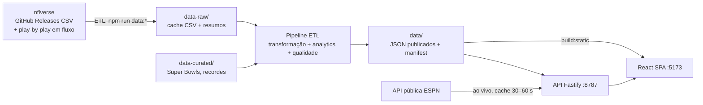

# End Zone Analytics — Especificação funcional

Documento de referência de **todas as páginas, funcionalidades e dados** da plataforma.
Reflete o estado atual do código (v1.3 — perfis de franquia, estatísticas por jogo, play-by-play resumido, elencos, expectativa do mercado, árbitros e revisão de segurança com teste de invasão). Site no ar: <https://end-zone-analytics.nfldata.workers.dev>. Itens marcados como **[Planejado]** ainda não existem.

> Documentos técnicos complementares: [docs/ARCHITECTURE.md](docs/ARCHITECTURE.md), [docs/DATA_MODEL.md](docs/DATA_MODEL.md), [docs/DATA_SOURCES.md](docs/DATA_SOURCES.md), [docs/API.md](docs/API.md), [docs/SECURITY.md](docs/SECURITY.md), [docs/ROADMAP.md](docs/ROADMAP.md).

---

## 1. Visão geral

| Item | Definição |
|---|---|
| Produto | Site sobre a NFL: dados, estatísticas, comparações, história, Super Bowl, analytics e educação |
| Público | Iniciantes (linguagem simples) e especialistas (EPA, CPOE, modelos) |
| Idioma | Português do Brasil (termos técnicos da NFL mantidos em inglês quando consagrados) |
| Princípios | Minimalista e profissional · **nunca inventar dados** · ausência = “Não disponível” (nunca 0) · fonte e data visíveis · ⓘ explicação em todo número relevante |
| Cobertura detalhada | Temporadas **1999 → atual** (nflverse: calendário com linhas de aposta e descanso, estatísticas por temporada e por jogo, play-by-play resumido, elencos); Draft desde 1980; Super Bowls I–LX e recordes oficiais por curadoria |

### Arquitetura resumida

- **Frontend:** React 19 + TypeScript 7 + Vite 6 + React Router 7 (cada página carregada sob demanda).
- **Backend:** Fastify 5 (helmet, compressão, rate limit, validação zod), somente leitura + rotas de administração.
- **Dados:** o CSV é lido **apenas na carga (ETL)**; em tempo de execução o site serve JSON pré-processado. Não há banco de dados.

---

## 2. Elementos globais (todas as páginas)

| Elemento | Comportamento |
|---|---|
| Cabeçalho | Logotipo (bola oval), Início + 6 menus (Temporada, Times, Jogadores, Estatísticas, História, Aprenda). Fontes e qualidade ficam no rodapé e no menu móvel |
| Busca global | `Ctrl K` (ou `⌘ K` no macOS) abre paleta de busca por páginas, times e jogadores |
| Seletor de temporada | Mostra “2026 · atual”; muda a temporada usada em todas as páginas |
| Modo Iniciante / Expert | Iniciante: explicações simples, sem jargão. Expert: colunas e métricas avançadas (EPA, CPOE…) e notas técnicas. Persistido no navegador. **O seletor só aparece nas páginas em que a troca muda algo visível** (caixas de explicação, colunas exclusivas do Expert, textos alternativos); nas demais fica oculto e o ⓘ deixa de sugerir a troca |
| Tema claro/escuro | Botão sol/lua; persistido no navegador; logos com versão para fundo escuro |
| Idioma dos termos (PT \| EN) | Seletor nos cartões com termos da ESPN (Game Center) e na classificação: português por padrão (V/D/E, “Conversões na 3ª descida”, decimais com vírgula) ou o original em inglês (W/L/T, “3rd down efficiency”). Persistido no navegador e aplicado a todos os cartões da página. Em qualquer idioma, passar o mouse (ou tocar) no termo mostra a tradução, o nome em inglês e uma descrição curta; o ⓘ de toda coluna e métrica do site também mostra o nome original em inglês |
| Aviso de atualização | Só para administradores autenticados: faixa quando há dados novos, com atualização em um clique |
| Tooltips ⓘ | Explicação de métricas e colunas, adaptada ao modo |
| Tabelas (DataTable) | Ordenação por coluna, legenda acessível, colunas só-Expert, exportação |
| Exportação | CSV (UTF-8 com BOM), JSON, SVG e PNG dos gráficos |
| Gráficos | Barras, colunas, linhas, radar e dispersão (SVG próprio, sem biblioteca externa) |
| Estados | Carregando (skeleton), vazio, erro com “Recarregar” (ErrorBoundary por página) |
| Acessibilidade | Link “Pular para o conteúdo”, foco visível, `aria-*`, contraste AA, testes axe-core |
| Rodapé | Mapa do site, fontes, licença, aviso de marcas registradas, data da última atualização |
| 404 | Página “Página não encontrada” com atalhos |

---

## 3. Mapa de páginas

| Rota | Página | Grupo do menu |
|---|---|---|
| `/` | Início | — |
| `/season` (abas `standings`, `schedule`, `leaders`, `playoffs`, `power`, `sos`, `efficiency`, `market`) | Temporada | Liga / Analytics |
| `/teams` · `/teams/:abbr` | Times · Perfil do time | Times & Jogadores |
| `/players` · `/players/:id` | Jogadores · Perfil do jogador | Times & Jogadores |
| `/compare` | Comparador | Times & Jogadores |
| `/matchup` (alias `/rivalries`) | Confrontos e rivalidades | Times & Jogadores |
| `/stadiums` | Estádios | Times & Jogadores |
| `/games/:id` | Página do jogo | — (via links) |
| `/super-bowl` · `/super-bowl/:n` | Super Bowl · Edição | História |
| `/records` | Recordes | História |
| `/draft` | Draft | História |
| `/hall-of-fame` | Hall of Fame | História |
| `/history` | História da NFL | História / Analytics |
| `/rankings` | Ranking de QBs | Analytics |
| `/explorer` | Explorador de dados | Analytics |
| `/referees` | Árbitros | Estatísticas |
| `/learn` | Comece aqui | Aprenda |
| `/rules` | Regras e faltas | Aprenda |
| `/positions` | Posições | Aprenda |
| `/playbook` | Playbook | Aprenda |
| `/strategy` | Estratégia | Aprenda |
| `/glossary` | Glossário | Aprenda |
| `/data` | Fontes e qualidade dos dados (pública) | Rodapé e menu móvel |
| `/admin` | Administração (protegida no servidor) | Fora do menu; ausente do build estático |
| `*` | Não encontrada | — |

---

## 4. Especificação por página

### 4.1 Início (`/`)
- **Hero:** “End Zone Analytics — O jogo em números.”, ilustração vetorial da bola oval, botões “Ver a temporada” e “Calendário completo”, atalho “Comece aqui”.
- **Números da base** (só valores reais): times ativos, jogos na temporada regular, Super Bowls na base, verificações de qualidade aprovadas.
- **Faixa de confiabilidade:** atualização relativa, último jogo registrado, link para fontes.
- **Jogos da semana:** cards com logos, placar, estado (agendado, ao vivo, intervalo, finalizado, adiado, cancelado, resultado indisponível) e horário no fuso local; navegação por botões e teclado. Jogo não disputado mostra “×”, nunca 0 × 0.
- **Painéis:** Classificação (Liga, AFC, NFC, Divisão; PF/PA/Div no modo Expert), Destaques da temporada (líder em passe, corrida, recepção e defesa, com critério e fonte; EPA/CPOE no Expert), Entenda o jogo (conteúdo editorial próprio).
- **Jogo em destaque**, **Líderes da temporada**, **Último Super Bowl**, **Mais títulos**, **Explore mais**.

### 4.2 Temporada (`/season`)
Abas (estado na URL `?tab=`):

| Aba | Conteúdo |
|---|---|
| Classificação | Por divisão, conferência ou liga. Colunas: W, L, T, PCT, PF, PA, DIFF, Casa, Fora, Div, Conf, Seq., Últ. 5 (Expert). Exportável |
| Calendário | Todos os jogos semana a semana, placar, ao vivo quando aplicável, link para o jogo |
| Líderes | Líderes por estatística (passe, corrida, recepção, defesa, chutes) |
| Playoffs | Chave interativa da temporada; aviso “Playoffs ainda não disputados” |
| Power ranking | Modelo transparente: Power Score (soma ponderada de z-scores), campanha, saldo/jogo, SOS, EPA/jogada, forma (4 jogos); seção “Como é calculado?” |
| Força de tabela | SOS jogado, SOS restante, jogos restantes; destaque “Tabela mais difícil até agora” |
| Eficiência | Ataque, defesa, times especiais e **situações** (3ª descida, 4ª descida — conversão e decisão de ir —, red zone, taxa de sucesso, EPA por jogada cedido; do play-by-play) de cada time com o ranking na liga (EPA por jogada, jardas e EPA cedidos, jogadas de 20+, first downs, turnovers, FG% de 40+, punt líquido, retornos); gráfico ataque × defesa |
| Zebras e expectativa | Favoritos que venceram/cobriram, % acima do total, vantagem de descanso; maiores zebras da temporada; tabela por time (contra a linha, como favorito/azarão, over-under, após folga) |

Observação: a classificação usa critério de desempate **simplificado** (informado na tela).

### 4.3 Times (`/teams`) e Perfil do time (`/teams/:abbr`)
- Lista: 32 franquias ativas por conferência/divisão, com logo, cores e campanha da temporada selecionada.
- Perfil — abas:
  - **Visão geral:** últimos 5 resultados, próximo jogo, tabela da divisão (time destacado), gráfico de pontos marcados/sofridos por jogo, “Vitórias por temporada”, Super Bowls, rivais.
  - **Eficiência:** cada métrica de ataque, defesa, times especiais e situações (3ª/4ª descida, red zone, sucesso) da temporada com o ranking na liga.
  - **Jogos** da temporada selecionada.
  - **Elenco:** destaques da temporada e elenco completo (ataque, defesa, times especiais) com número, posição, idade, altura, peso, experiência, universidade, draft e situação; idade e experiência médias, novatos.
  - **Recordes:** líderes da franquia na temporada regular (carreira no time ou uma temporada), 10 estatísticas, top 5.
  - **História:** ficha (nomes/cidades, ex.: OAK → LV; estádios com nomes de patrocínio), momentos marcantes (melhor/pior temporada, maiores sequências, maiores vitórias e derrotas), técnicos (campanha jogo a jogo, inclusive interinos), QBs titulares, Super Bowls e temporada a temporada.
  - **Confrontos:** desempenho por situação (casa, fora, divisão, até 8 pontos, prorrogação, coberto/ao ar livre, após folga, descanso curto, playoffs), contra a expectativa do mercado (ATS, favorito/azarão, over-under, por temporada, maiores zebras a favor) e retrospecto contra cada adversário com link para o histórico.
  - **Draft:** escolhas desde 1980, Hall of Fame draftados, melhores escolhas por AV e a classe mais recente (códigos antigos, ex.: Oilers → TEN, mapeados para a franquia atual).
  - **Times semelhantes** (similaridade).
  - Dados das abas Recordes/História/Confrontos/Draft: `data/teams/{CODE}.json`.

### 4.4 Jogadores (`/players`) e Perfil (`/players/:id`)
- Busca sem acento/maiúsculas, filtro por posição (QB, RB, WR, TE, OL, DL, LB, DB, K, P), colunas primeira/última temporada e último time; filtros na URL.
- Perfil:
  - Bio (foto, posição, universidade, altura, peso, nascimento, draft, número, status).
  - **Carreira — temporada regular** e playoffs; aviso “Carreira parcial” quando começou antes de 1999.
  - **Temporada a temporada** com métricas por posição (ex.: CMP%, Y/A, EPA/DB, Y/R, jogadas de 20+, first downs; recebedores: participação nos alvos, nas jardas aéreas e WOPR; kickers: 50+ e FGs da vitória; punters: média líquida, dentro da 20, touchbacks).
  - **Jogo a jogo:** gráfico por jogo da temporada escolhida, tabela com adversário e resultado, melhores jogos da carreira.
  - **Field goals por distância** (kickers), **retornos** (quem retornou 5+ vezes) e **valor de draft** (AV real × esperado para a escolha, posição na classe).
  - Gráfico de evolução e radar por percentil (QB, RB, WR/TE, defensores, kickers e punters).
  - **Jogadores semelhantes** (similaridade estatística).

### 4.5 Comparador (`/compare`)
Três modos:
- **Jogadores:** lado a lado (atalhos prontos: Brady × Mahomes, Brady × Manning, Mahomes × Allen, Moss × Fitzgerald, J. J. Watt × Aaron Donald), totais e por jogo, radar, **ajuste de era**, longevidade, playoffs, participações em Super Bowl.
- **Times:** campanha desde 1999, pontos marcados/sofridos por jogo, EPA por jogada, melhor temporada.
- **Temporadas:** uma temporada de time contra outra.

### 4.6 Confrontos e rivalidades (`/matchup`)
- Escolha de dois times (validação “Escolha dois times diferentes”).
- Retrospecto, **linha do tempo dos confrontos**, tabela “Todos os jogos” (data, tipo, placar, vencedor, estádio).
- Rivalidades clássicas pré-configuradas. Cobertura: desde 1999.

### 4.7 Página do jogo (`/games/:id`)
- Ficha do jogo (estádio, cidade, teto, gramado, clima em °C e km/h, público, QBs, técnicos, árbitro, **dias de descanso de cada time**). **Só aparecem as informações disponíveis** — nada de “Não disponível”. O árbitro vem da nflverse ou, em jogos recentes, da equipe de arbitragem informada pela ESPN.
- Termos da ESPN traduzidos: estatísticas dos times (25, com explicação ao passar o mouse), destaques (“17 corridas, 41 jardas”), descrições das pontuações (“corrida de 4 jardas (ponto extra de …)”), drives (“8 jogadas, 20 jardas”) e situação ao vivo (“8:24 · 3º quarto”, “Intervalo”); seletor PT | EN para ver os originais.
- **Expectativa do mercado:** favorito e linha, total esperado, chance de vitória (moneyline sem a margem da casa), resultado contra a linha e o total; selo “Zebra” quando o azarão vence.
- **Árbitro:** retrospecto do árbitro principal (jogos, pontos por jogo, mandante, acima do total).
- **Box score** (dados publicados, funciona sem a ESPN): passe, corrida, recepção, defesa, chutes, punts e retornos. Em largura total abaixo das duas colunas; a partir de 1100 px os dois times aparecem lado a lado, seção a seção, com colunas idênticas; em telas menores, um time por vez com seletor.
- **Probabilidade de vitória** dos dois times (linhas complementares), com seletor “Os dois | visitante | mandante”.
- Jogadas de pontuação com a descrição sempre visível (traduzida).
- Placar por quarto, **evolução do placar**, jogadas de pontuação, drives, destaques, estatísticas dos times.
- Probabilidade de vitória jogada a jogada (modelo da ESPN).
- “Antes deste jogo”: contexto das campanhas e confrontos.
- Quando a ESPN não tem detalhes: aviso “Detalhes jogada a jogada indisponíveis”.

### 4.8 Super Bowl (`/super-bowl`) e Edição (`/super-bowl/:n`)
- Todas as edições I–LX: temporada, campeão, vice, placar, MVP, estádio.
- Gráfico “Diferença de pontos em cada Super Bowl” (barras na cor do campeão; clique abre a edição).
- Edição: ficha (técnicos, QBs, MVP, prorrogação), links para jogo/times.

### 4.9 Recordes (`/records`)
Abas: **Oficiais (todos os tempos)** · Temporada (1999+) · Carreira (1999+) · Playoffs (1999+) · Times · Jogos (inclui as maiores zebras pela linha) · **Times especiais** (FGs, 50+, FGs da vitória, FG%, FGs mais longos, punt líquido, dentro da 20, jardas e TDs de retorno).
- Detecção de recorde em andamento: líder atual × recorde oficial, com ritmo projetado para 17 jogos.

### 4.10 Draft (`/draft`)
- Escolhas por ano desde 1980 (rodada, pick, time, jogador, posição, universidade, AV, Pro Bowls, All-Pro, HOF).
- **Valor de carreira por número de escolha** (gráfico), **Draft Value Score**, melhores por rodada, maiores “achados”.
- **Escolhas altas que não renderam** (top 10 abaixo do esperado), **Quem drafta melhor** (valor acima do esperado por franquia, 2000+) e **Valor por posição** (AV médio na 1ª rodada e no geral).
- Só drafts “maduros” entram na análise de valor. AV = AV ponderado de carreira (PFR).

### 4.11 Hall of Fame (`/hall-of-fame`)
- Membros **draftados desde 1980** (limitação informada em “Cobertura desta página”), com draft, time que draftou, AV, Pro Bowls, All-Pro, jogos e última temporada.

### 4.12 História da NFL (`/history`)
- Linha do tempo por eras (1920 → hoje) e “O que mudou” em cada uma.
- **Evolução do jogo em números** (1999+): pontos por jogo, jardas de passe/corrida, taxa de passe, sacks, turnovers, vitórias do mandante, diferença média, FG% e XP%.
- Médias por década e comparação entre eras.

### 4.13 Estádios (`/stadiums`)
- Estádio, times, teto, gramado (tipo e marca do sintético), jogos (1999+), pontos por jogo, vitórias do mandante, temperatura e vento médios, FG%, Super Bowls sediados e período de uso (1999+). A tabela cabe na largura do conteúdo, sem rolagem lateral; dado ausente aparece como “—”.

### 4.13.1 Árbitros (`/referees`)
- Árbitros principais com 16+ jogos desde 1999: período, jogos, playoffs, Super Bowls, pontos por jogo, vitórias do mandante, % acima do total, prorrogações; filtro “em atividade”.

### 4.14 Ranking de QBs (`/rankings`)
- Modelo **EZA-QB v1** baseado em dados, com **pesos ajustáveis** e predefinições: Equilibrado (padrão), Só eficiência, Só títulos, Volume e longevidade.
- Componentes: anos, jardas, TD, rating, EPA/DB, ajuste de era (+Era), playoffs, Super Bowls.
- Elegibilidade: mínimo de 1.500 tentativas.

### 4.15 Explorador de dados (`/explorer`)
- Monta rankings de **Jogadores** ou **Times (temporadas)**: fase (temporada regular/playoffs), período, “por temporada” ou “total do período”, posição, métrica, ordenação.
- Volume mínimo para métricas de taxa; filtros na URL; exportação.
- Consultas prontas (ex.: ataques mais eficientes por EPA/jogada, mais sacks desde 2015).

### 4.16 Aprenda
| Página | Conteúdo |
|---|---|
| Comece aqui (`/learn`) | “A NFL em 10 minutos”: o campo, como se pontua, fluxo de um jogo, **Simulador de Down & Distance** |
| Regras e faltas (`/rules`) | Regras avançadas, penalidades (descrição, jardas, sinal) e equipe de arbitragem |
| Posições (`/positions`) | Campo interativo; ataque, defesa e times especiais; responsabilidades, movimentação, porte típico, nota técnica |
| Playbook (`/playbook`) | 29 jogadas e coberturas **animadas**: “Funciona contra”, “Ponto fraco”; explicação técnica no modo Expert |
| Estratégia (`/strategy`) | Relógio, 4º down, red zone e mais; **teste uma decisão de 4º down** |
| Glossário (`/glossary`) | Termos do básico ao avançado, busca, termos relacionados, link direto por âncora |

### 4.17 Fontes e qualidade dos dados (`/data`, pública)
Última atualização publicada, cobertura, verificações, como os números chegam ao site (coleta → transformação → validação → publicação), fontes e licenças, limitações conhecidas, tabela de qualidade e API pública. Sem controles de carga, tokens ou histórico operacional.

### 4.18 Administração (`/admin`)
Autorização sempre no servidor (sessão em cookie `HttpOnly`/`SameSite=Strict` via `ADMIN_TOKEN`; acesso local liberado só fora de produção).
- **Visão geral:** API, arquivos publicados, última publicação bem-sucedida × última tentativa, qualidade, token do GitHub, alertas (carga falha, token ausente, arquivos faltando), conjuntos publicados com versão e sha256.
- **Fontes e cargas:** verificação de dados novos (fonte indisponível ≠ atualizado), carga parcial/completa com fontes e temporadas, confirmação para carga completa, progresso e log do job, comando equivalente no terminal, execuções recentes (painel e terminal).
- **Logs e alertas:** severidade, componente, job, mensagem, ação recomendada, detalhes técnicos, resolvido/em aberto; filtros por severidade, componente e período.
- **Histórico:** publicações (ingestões) e todas as execuções.

---

## 5. Funcionalidades de dados (carga e atualização)

| Modo | Comando | O que faz |
|---|---|---|
| Completa | `npm run data:full` | Baixa e reprocessa todas as fontes (~230 arquivos, ~850 MB com estatísticas por jogo e play-by-play; 5–15 min local, ~4 min no GitHub Actions) |
| Parcial | `npm run data:partial` | Sem filtros: incremental (baixa só arquivos com versão remota diferente). Com filtros: força fontes/temporadas escolhidas |
| Verificação | `npm run data:check` | Só compara versões locais × remotas, sem baixar |
| Qualidade | `npm run data:quality` | Reexecuta as verificações sobre os dados publicados |

Regras do pipeline:
- Cache em `data-raw/` com `.meta.json` (versão, data, URL); escrita atômica (arquivo temporário + troca, com nova tentativa no Windows).
- Até 3 tentativas por download; em falha, usa o cache local.
- Uma nova publicação só é criada quando o conteúdo muda (sha256 dos conjuntos ou resultado da qualidade). Nesse caso, o manifest anterior vai para `data/history/` e `history/changes.json` registra o que mudou (conjuntos e variação de linhas). Sem mudanças, a publicação é mantida e só `lastCheckedAt` é atualizado.
- Cargas automáticas pelo agendador interno (`SYNC_*`), registradas como “Agendada” no admin; falhas e alertas podem ser enviados por webhook.
- Verificações de qualidade: alertas não bloqueiam a publicação; falhas aparecem na página de dados e quebram o teste `published.test.ts`.

Verificações de qualidade atuais (18): 32 franquias ativas; IDs de jogos únicos; times dos jogos existem; placares não negativos e completos; nenhum time contra si mesmo; nenhum placar no futuro; 16/17 jogos por time em temporadas encerradas; formato dos playoffs; uma linha por jogador/temporada/fase; estatísticas possíveis; alvos consistentes com recepções (inconsistentes viram “Não disponível”); passer rating em 0–158,3; todos os jogadores com nome; pick único por draft; Super Bowls em sequência; Super Bowls conferem com nflverse; recordes de temporada conferem; estatísticas não superam recordes oficiais (divergências conhecidas ficam documentadas em `knownDivergences` na curadoria).

**Limitações conhecidas**
- A verificação usa a API do GitHub: sem `GITHUB_TOKEN`, o limite é **60 requisições/hora por IP** (HTTP 403). Com token: 5.000/h. O erro informa o horário de liberação e a ação recomendada.
- Requisições condicionais (ETag) evitam gastar o limite quando nada mudou; o cache de versões é renovado a cada execução.
- Se a lista de versões não puder ser consultada, a carga parcial **falha com erro explícito** (não reporta sucesso sem atualizar). Execuções e falhas ficam registradas em `ops/` e aparecem no admin.
- Publicação em produção: Cloudflare Workers com static assets (`wrangler.jsonc`) + GitHub Actions (carga parcial a cada 6 h, portão de qualidade, republica só quando algo muda; placar ao vivo em `worker/index.ts`). Configuração: [docs/PUBLICACAO.md](docs/PUBLICACAO.md); operação: [docs/PUBLICACAO_SERVIDOR.md](docs/PUBLICACAO_SERVIDOR.md).

---

## 6. Dados

### 6.1 Fontes

| Conjunto | Fonte | Licença | Cobertura |
|---|---|---|---|
| Times, cores e logos | nflverse (`teams`) | CC-BY 4.0; logos são marcas dos detentores (CDN ESPN) | Atual + nomes históricos |
| Calendário e resultados | nflverse (`schedules`) | CC-BY 4.0 | 1999 → atual |
| Cadastro de jogadores | nflverse (`players`) | CC-BY 4.0 | Todos |
| Estatísticas de jogadores | nflverse (`stats_player`, REG/POST por temporada) | CC-BY 4.0 | 1999 → atual |
| Estatísticas de times | nflverse (`stats_team`) | CC-BY 4.0 | 1999 → atual |
| Estatísticas por jogo (jogadores e times) | nflverse (`stats_player_week`, `stats_team_week`) | CC-BY 4.0 | 1999 → atual |
| Play-by-play (resumo situacional por time) | nflverse (`pbp`) | CC-BY 4.0 | 1999 → atual |
| Elencos | nflverse (`rosters`) | CC-BY 4.0 | 1999 → atual |
| Draft | nflverse (`draft_picks`, derivado de Pro Football Reference) | CC-BY 4.0 | 1980 → atual |
| Super Bowls I–LX e recordes oficiais | Curadoria (`data-curated/`, NFL Record & Fact Book) | Fatos; texto próprio | Todos os tempos |
| Ao vivo (placar, drives, probabilidade de vitória) | API pública do site da ESPN | Sem garantia de disponibilidade | Temporada atual |

### 6.2 Arquivos publicados (`data/`)

| Arquivo | Conteúdo |
|---|---|
| `manifest.json` | Versão do schema, data de geração, `ingestionVersion`, último modo, cobertura (primeira/última/atual temporada, semana, último jogo), metadados por conjunto (fonte, URL, licença, versão remota, linhas, sha256), resumo de qualidade |
| `quality.json` | Resultado de cada verificação (id, conjunto, descrição, status, detalhe) |
| `teams.json` | abbr, nome, apelido, conferência, divisão, cores, logo claro/escuro, wordmark, franquia, ativo |
| `games/all.json`, `games/{ano}.json` | id, temporada, tipo (REG/WC/DIV/CON/SB), semana, data/hora, times, placar, prorrogação, campo neutro, jogo de divisão, teto, gramado, temperatura, vento, QBs, técnicos, árbitro, estádio, ID ESPN, linha de fechamento (spread, total, moneylines), dias de descanso |
| `stats/players-{ano}.json` | Por jogador/temporada/fase: jogos; passe (cmp, att, jardas, TD, INT, sacks, EPA, CPOE, air yards); corrida (tentativas, jardas, TD, EPA); recepção (rec, alvos, jardas, TD, YAC, EPA); defesa (tackles, TFL, sacks, QB hits, INT, PD, FF, TD); chutes (FG, XP, punts); fumbles perdidos; fantasy |
| `stats/teams-{ano}.json` | Totais de time: passe, corrida, EPA, sacks, INT, fumbles, penalidades, chutes, TD de times especiais |
| `players/index.json` | Índice de busca: id, nome, posição, último time, primeira/última temporada |
| `players/careers/NN.json` | Bio + todas as temporadas + semelhantes; 64 arquivos (bucket = FNV-1a(id) mod 64) |
| `team-seasons.json` | Por time/temporada: W-L-T, PF, PA, playoffs, título, EPA, jogadas, takeaways/giveaways, técnico, QB principal |
| `trends.json` | Médias da liga por temporada (pontos, mandante, margem, prorrogação, passe/corrida, sacks, turnovers, FG%, XP%) |
| `superbowls.json` | Número, romano, temporada, data, estádio, cidade, campeão/vice, placar, prorrogação, MVP, técnicos, QBs, `gameId`, fonte |
| `records-curated.json` / `records-computed.json` | Recordes oficiais / top 10 calculados (1999+) |
| `teams/{CODE}.json` | Perfil da franquia: identidades, estádios, técnicos, QBs, splits, retrospecto, momentos, líderes, draft |
| `draft.json` | Temporada, rodada, pick, time, jogador, posição, universidade, idade, AV, Pro Bowls, All-Pro, HOF, jogos |
| `stadiums.json` | Estádio, times, teto, gramado, jogos, primeiro/último, Super Bowls, pontos por jogo, vitórias do mandante, temperatura e vento médios, FG% |
| `rosters/{ano}.json` | Elenco de cada time: número, posição, idade, altura, peso, experiência, universidade, draft, situação |
| `referees.json` | Árbitros com 16+ jogos: período, jogos, playoffs, Super Bowls, pontos por jogo, mandante, % acima do total, prorrogações |
| `players/gamelogs/NN.json` | Jogo a jogo por jogador (mesmos buckets dos perfis) |
| `boxscores/{ano}/{semana}.json` | Estatísticas individuais de todos os jogos da rodada (box score) |
| `models/qb-model.json` | Componentes brutos do ranking de QBs |
| `history/` | Manifests anteriores e log de mudanças |

Convenções: arquivos grandes em formato colunar `{cols, rows}`; ausência = `null` (exibida como “Não disponível”); temporada = ano de início (Super Bowl LX, fev/2026 → temporada 2025); IDs estáveis (time = abreviação nflverse, jogo = `game_id`, jogador = GSIS ID).

### 6.3 Banco de dados
Hoje não há banco: o volume (~180 MB, com jogo a jogo e box scores carregados sob demanda) e o uso somente leitura são atendidos por JSON.
**[Planejado]** SQLite/DuckDB como destino do ETL quando houver dados de jogada a jogada, consultas livres no Explorador ou contas de administrador; PostgreSQL apenas para várias instâncias ou muitos usuários escrevendo.

---

## 7. API REST

Base `http://localhost:8787`. Somente leitura, exceto `/api/admin/*`. Especificação em `/api/openapi.json`.

| Método | Rota | Descrição |
|---|---|---|
| GET | `/health`, `/ready` | Saúde do processo / dados carregados (`ingestionVersion`) |
| GET | `/api/openapi.json` | Documentação OpenAPI 3.1 |
| GET | `/api/meta`, `/api/quality`, `/api/changes` | Manifest, qualidade, histórico de mudanças |
| GET | `/api/teams`, `/api/teams/:abbr` | Franquias ativas / perfil (404 se inexistente) |
| GET | `/api/games?season&team&week&type&limit`, `/api/games/:id` | Jogos filtrados / jogo |
| GET | `/api/standings?season` | Classificação calculada (desempate simplificado) |
| GET | `/api/players?q&pos&limit`, `/api/players/:id` | Busca / carreira do jogador |
| GET | `/api/stats/leaders?season&stat&limit` | Líderes (400 para estatística desconhecida ou que não seja coluna numérica) |
| GET | `/api/super-bowls`, `/api/super-bowls/:n` | Super Bowls |
| GET | `/api/records`, `/api/draft` | Recordes / draft |
| GET | `/api/rankings/qb` | Ranking de QBs |
| GET | `/api/live/scoreboard`, `/api/live/game/:espnId` | Ao vivo via ESPN (cache 30 s / 60 s); só IDs de jogos da base (404 para os demais) |
| GET/POST | `/api/admin/session` (GET), `/api/admin/login`, `/api/admin/logout` (POST) | Sessão administrativa |
| GET | `/api/admin/check` | Verifica dados novos (cache 10 min) 🔒 |
| POST | `/api/admin/sync` | Inicia carga `{mode, datasets?, seasons?}` → 202 + job (máx. 5/min) 🔒 |
| GET | `/api/admin/jobs`, `/api/admin/jobs/:id` | Status das cargas 🔒 |
| GET | `/api/admin/overview`, `/api/admin/events` | Painel e logs/alertas 🔒 |

Segurança: 🔒 = sessão administrativa, `Authorization: Bearer <ADMIN_TOKEN>` ou acesso local (só fora de produção); ações por cookie exigem `X-EZA-Admin: 1`; rate limit geral de 600 req/min e 5/min para login e sync; trava global após 20 tokens errados em 15 min (login ou Bearer); IP do cliente só de `X-Forwarded-For` com `TRUST_PROXY`; cabeçalhos CSP, HSTS, `nosniff`, `X-Frame-Options: DENY`, `Permissions-Policy`; parâmetros validados com zod; corpo ≤ 32 KB.

---

## 8. Configuração

| Variável | Uso |
|---|---|
| `API_PORT` | Porta da API (padrão 8787) |
| `HOST` | Interface de rede |
| `ADMIN_TOKEN` | Login da área administrativa (obrigatório em produção; com menos de 24 caracteres o login fica desativado). Gere com `openssl rand -base64 32` |
| `TRUST_PROXY` | Quantos proxies à frente da API são confiáveis para ler o IP real (0 = API exposta direto, padrão; 1 = atrás do Caddy do docker-compose) |
| `OPS_DIR` | Log operacional privado (padrão `ops/`) |
| `SITE_URL` | URL pública usada para gerar `sitemap.xml` no `build:static` |
| `SYNC_PARTIAL_EVERY_HOURS`, `SYNC_FULL_WEEKDAY`, `SYNC_FULL_HOUR_UTC` | Agendador interno de cargas (parcial a cada N h; completa semanal) |
| `ALERT_WEBHOOK_URL`, `ALERT_WEBHOOK_FORMAT`, `ALERT_MIN_SEVERITY` | Alertas externos (ntfy, Discord, Slack) |
| `DOMAIN`, `ACME_EMAIL` | Domínio e e-mail do HTTPS automático (Caddy) no `docker compose` |
| `GITHUB_TOKEN` | Aumenta o limite da API do GitHub (verificação de versões) |
| `FIRST_SEASON` | Primeira temporada da cobertura detalhada (padrão 1999) |
| `NODE_ENV` | `production` serve o build estático pela API |

Scripts: `dev`, `dev:web`, `dev:api`, `build`, `build:static`, `start`, `preview`, `data:full`, `data:partial`, `data:check`, `data:quality`, `typecheck`, `test`, `test:e2e`, `spell`, `qa`.

---

## 9. Publicação

| Item | Como funciona |
|---|---|
| Hospedagem | Cloudflare Workers: *static assets* (`dist/` + `dist/data`, CDN, HTTPS, `public/_headers`) e `worker/index.ts` só para `/api/live/*` |
| Endereço | <https://end-zone-analytics.nfldata.workers.dev> (domínio próprio opcional) |
| Quem atualiza os dados | GitHub Actions `publish.yml`: cron a cada 6 h, a cada push e manual (`partial`/`full`) |
| Portão de qualidade | `tests/data/published.test.ts`: dados reprovados não são publicados; o site segue com os anteriores |
| Equivalente do `/admin` | Aba Actions (jobs, logs, resumo do que mudou), painel da Cloudflare (Deployments/rollback, Observability, Metrics), página pública `/data` |
| Eventos e alertas | E-mail do GitHub em falhas; ntfy opcional (`NTFY_URL`); UptimeRobot opcional em `/data/manifest.json` |
| Segredos | `CLOUDFLARE_API_TOKEN` (modelo *Edit Cloudflare Workers*) e `CLOUDFLARE_ACCOUNT_ID` em GitHub Secrets |
| Custo | R$ 0 (planos grátis da Cloudflare e do GitHub, sem cartão) |
| API completa e `/admin` online | Exigem servidor Node.js (hospedagem própria, fora do plano grátis) — referência em `docs/DEPLOYMENT.md` |

Guias: [docs/PUBLICACAO.md](docs/PUBLICACAO.md) (configuração) · [docs/PUBLICACAO_SERVIDOR.md](docs/PUBLICACAO_SERVIDOR.md) (operação).

---

## 10. Qualidade e testes

| Tipo | Ferramenta | Cobertura |
|---|---|---|
| Tipos | `tsc` | Todo o projeto |
| Unitários / componentes | Vitest + Testing Library | Bibliotecas, componentes, ETL (transformação, analytics, qualidade), API (`fastify.inject`), dados publicados |
| E2E + acessibilidade | Playwright + axe-core | Navegação de todas as páginas, fluxos principais, violações WCAG |
| Ortografia | cspell (pt-BR + en) | Código, docs e curadoria |
| Segurança | Vitest + teste de invasão manual | Força bruta, IP forjado, CSRF, path traversal, XSS, injeção em parâmetros, CSV injection, cabeçalhos, Worker; relatório em `docs/SECURITY.md` |
| Dependências | `npm audit` + Dependabot | CI e publicação falham com vulnerabilidade alta; PRs semanais de atualização |

Critério de pronto: `npm run qa` e `npm run test:e2e` sem falhas; `npm audit` sem vulnerabilidade alta.

---

## 11. Melhorias planejadas (resumo)

| Prioridade | Item |
|---|---|
| P1 | E2E no CI (hoje o CI roda `qa`, build e auditoria; E2E é local) |
| P2 | Pré-renderização (SSG) das páginas públicas para SEO; regressão visual automatizada por screenshot |
| P2 | Time favorito; filtros compartilháveis em todas as tabelas; onboarding de 3 passos |
| Futuro | SQLite/DuckDB; play-by-play completo (mapas de campo, probabilidade de vitória própria); simulador de playoffs; prêmios; dados pré-1999 |
