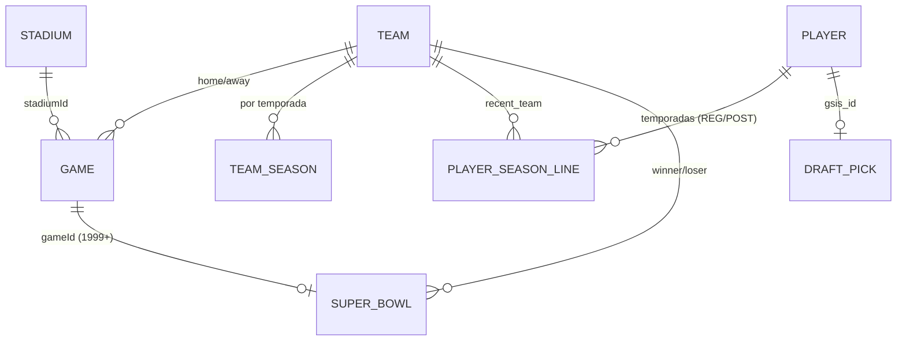

# Modelo de dados

Fonte da verdade: [`src/lib/types.ts`](../src/lib/types.ts). Arquivos grandes usam formato colunar `{ "cols": [...], "rows": [[...]] }` (ver `src/lib/pack.ts`); o cliente e a API convertem de volta para objetos.

## Entidades e relações

## IDs estáveis

| Entidade | ID | Exemplo |
|---|---|---|
| Time | abreviação nflverse; `franchise` = franquia atual | `OAK` → franquia `LV` |
| Jogo | `game_id` nflverse | `2025_22_SEA_NE` |
| Jogador | GSIS ID | `00-0033873` (Patrick Mahomes) |
| Super Bowl | número | `60` |
| Estádio | `stadium_id` nflverse | `SFO01` |

## Arquivos

| Arquivo | Tipo | Conteúdo |
|---|---|---|
| `manifest.json` | `Manifest` | Cobertura, versões por arquivo de origem, sha256, linhas, resumo de qualidade |
| `quality.json` | `QualityCheck[]` | Resultado das validações |
| `teams.json` | `Team[]` | Nome, apelido, conferência, divisão, cores, logo claro/escuro, franquia, ativo |
| `games/all.json`, `games/{ano}.json` | `Game[]` | Placar, tipo (REG/WC/DIV/CON/SB), semana, data, local, teto, gramado, clima, QBs, técnicos, árbitro, estádio, ID ESPN |
| `stats/players-{ano}.json` | `PlayerSeasonLine[]` | 44 colunas por jogador/temporada/fase (REG/POST) |
| `stats/teams-{ano}.json` | `TeamSeasonLine[]` | Totais ofensivos/defensivos/times especiais |
| `players/index.json` | `PlayerIndexEntry[]` | Busca: id, nome, posição, último time, primeira/última temporada |
| `players/careers/NN.json` | `Record<id, PlayerCareer>` | Bio + temporadas + jogadores semelhantes (bucket = FNV-1a(id) mod 64) |
| `team-seasons.json` | `TeamSeason[]` | W-L-T, PF, PA, playoffs, título, EPA, técnico, QB principal |
| `trends.json` | `LeagueTrend[]` | Médias da liga por temporada |
| `superbowls.json` | `SuperBowl[]` | I–LX, curadoria + enriquecimento nflverse |
| `records-curated.json` | `CuratedRecord[]` | Recordes oficiais de todos os tempos |
| `records-computed.json` | — | Top 10 por estatística (temporada, carreira, playoffs), times e jogos (1999+) |
| `draft.json` | `DraftPick[]` | 1980+, AV, Pro Bowls, All-Pro, HOF |
| `teams/{CODE}.json` | `TeamProfile` | Perfil de cada franquia ativa: identidades, estádios, técnicos, QBs titulares, desempenho por situação, retrospecto por adversário, momentos marcantes, líderes da franquia e draft (calculado no pipeline) |
| `stats/teams-{ano}.json` (campos situacionais) | `TeamSeasonLine` | Do play-by-play: `thirdAtt/thirdConv`, `fourthOpp/fourthAtt/fourthConv`, `rzTrips/rzTd`, `plays/epa/success` e os equivalentes cedidos pela defesa (prefixo `d`) |
| `stadiums.json` | `Stadium[]` | Teto, gramado, jogos, Super Bowls, pontos por jogo, vitórias do mandante, clima médio, FG% |
| `rosters/{ano}.json` | `RosterEntry[]` (colunar) | Elenco de cada time na temporada: número, posição, idade, altura, peso, experiência, universidade, draft, situação |
| `referees.json` | `RefereeSummary[]` | Árbitros principais (16+ jogos): jogos, playoffs, pontos por jogo, mandante, % acima do total |
| `players/gamelogs/NN.json` | `{ [id]: PlayerGameLine[] }` (colunar) | Jogo a jogo de cada jogador; mesmos 64 buckets dos perfis |
| `boxscores/{ano}/{semana}.json` | `PlayerGameLine[]` (colunar) | Box score de todos os jogos da rodada |
| `injuries/{ano}.json` | `InjuryEntry[]` | Semana mais recente de cada time: jogador, posição, lesão, treino e status do jogo (Out, Doubtful, Questionable) |
| `fantasy/{ano}.json` | `FantasySeason` | PPR por jogador (total, média, desvio, piso, teto, semanas no top 12, pontos por semana) e pontos cedidos por defesa × posição, com ranking |
| `awards.json` | `AwardsData` | Prêmios da AP: vencedores (temporada, nome, time, ID do jogador quando 1999+), prêmios rejeitados na conferência, fonte e licença |
| `wiki/teams.json` | `Record<sigla, TeamWiki>` | Resumo da Wikipedia em português, título, URL e data da última edição do artigo |
| `models/qb-model.json` | `QbModelEntry[]` | Componentes brutos do ranking de QBs |
| `history/` | — | Manifests anteriores e log de ingestões |

## Convenções

- Ausência de dado = `null`. Contagens vazias (ex.: sacks em um jogo sem sacks) = `0`.
- EPA/CPOE arredondados (2 casas); valores derivados (rating, percentuais) são calculados no consumo.
- Temporada = ano de início (o Super Bowl LX, em fevereiro de 2026, pertence à temporada 2025).
