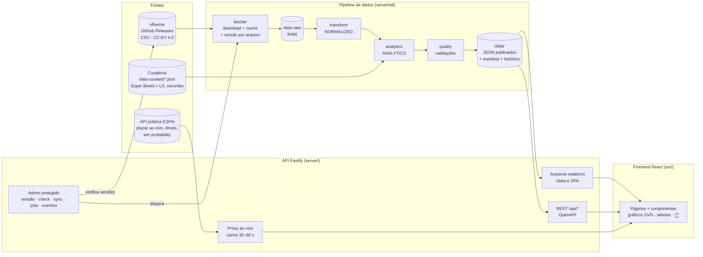
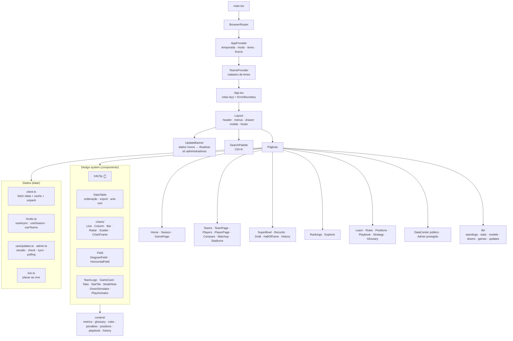
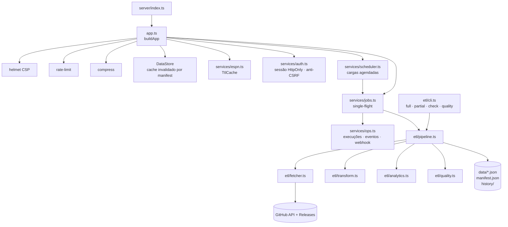
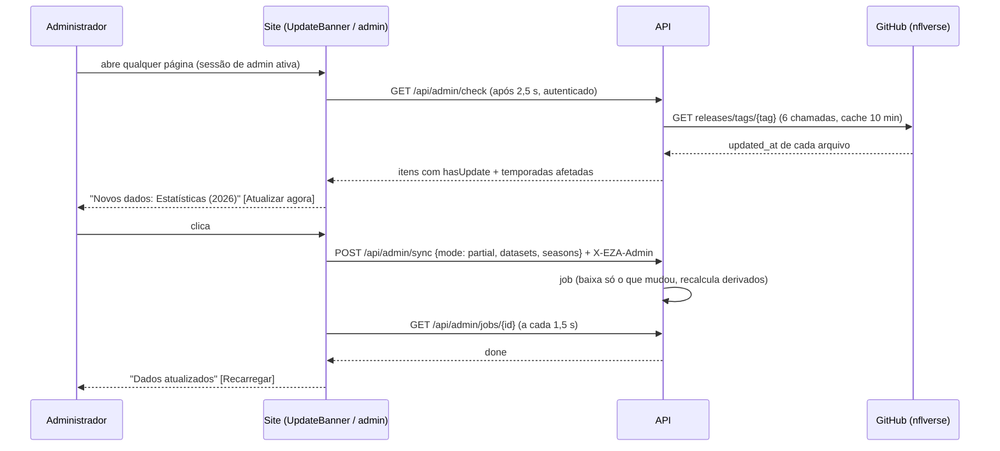

# End Zone Analytics — Guia completo

Este guia explica o que o projeto faz, como está organizado, como os dados chegam até a tela e como operar, testar e evoluir a plataforma. Para começar em 3 comandos, veja o [README](../README.md). Para publicar na internet, veja [PUBLICACAO.md](PUBLICACAO.md).

**Sumário**

1. [Visão do produto](#1-visão-do-produto)
2. [Arquitetura macro](#2-arquitetura-macro)
3. [Arquitetura micro](#3-arquitetura-micro)
4. [Pipeline de dados](#4-pipeline-de-dados)
5. [Carga completa, parcial e detecção de dados novos](#5-carga-completa-parcial-e-detecção-de-dados-novos)
6. [Frontend: páginas e funcionalidades](#6-frontend-páginas-e-funcionalidades)
7. [Modelos e métricas calculadas](#7-modelos-e-métricas-calculadas)
8. [Princípios de dados (regra de ouro)](#8-princípios-de-dados-regra-de-ouro)
9. [Design, UX e acessibilidade](#9-design-ux-e-acessibilidade)
10. [Qualidade: testes, QA, UX e revisão de texto](#10-qualidade-testes-qa-ux-e-revisão-de-texto)
11. [Operação](#11-operação)
12. [Estrutura de diretórios](#12-estrutura-de-diretórios)
13. [Limitações conhecidas e roadmap](#13-limitações-conhecidas-e-roadmap)

---

## 1. Visão do produto

Uma enciclopédia interativa, banco de dados histórico e laboratório de analytics da NFL, em português, que atende ao mesmo tempo:

- **Iniciantes** — explicações simples em cada número (botão ⓘ), página “A NFL em 10 minutos”, simulador de down & distance, posições num campo interativo e playbook animado.
- **Especialistas** — EPA, CPOE, percentis, ajuste de era, power ranking transparente, explorador de dados com exportação.

O seletor **Iniciante / Expert** no topo muda as notas explicativas, as colunas avançadas e os textos alternativos; ele só aparece nas páginas em que a troca muda algo visível. O seletor de **temporada** no cabeçalho faz todas as páginas respeitarem o ano escolhido (1999–hoje).

## 2. Arquitetura macro



Em produção o site roda como **site estático + Cloudflare Worker** (placar ao vivo), atualizado pelo GitHub Actions a cada 6 h — ver [PUBLICACAO.md](PUBLICACAO.md). Operação do dia a dia: [PUBLICACAO_SERVIDOR.md](PUBLICACAO_SERVIDOR.md). A API REST completa e o `/admin` exigem um servidor Node.js (uso local ou hospedagem própria — ver [DEPLOYMENT.md](DEPLOYMENT.md)).

**Decisões principais**

| Decisão | Por quê |
|---|---|
| Dados publicados como **JSON estáticos versionados** (`data/`) em vez de banco relacional | Leitura 100% do tempo, poucos MB, cache simples e o site funciona sem servidor (é assim que está publicado). O contrato é tipado em `src/lib/types.ts`; adotar um banco depois só muda a camada de publicação (ver roadmap). |
| **Lógica compartilhada** (`src/lib`) entre pipeline, API e frontend | Uma única implementação de classificação, passer rating, percentis, modelos e verificação de atualização — testada uma vez. |
| **Formato colunar** (`{cols, rows}`) para arquivos grandes | ~70% menos bytes que lista de objetos. |
| **Perfis de jogadores em 64 “buckets”** | O perfil de um jogador baixa ~200 KB em vez de todo o banco. |
| **Gráficos SVG próprios** | Sem dependências pesadas, tema claro/escuro por tokens CSS, tooltips, “ver como tabela” e exportação PNG/SVG/CSV. |

## 3. Arquitetura micro

### Frontend



### Servidor e pipeline



### Sequência: “há dados novos?”



Visitantes comuns nunca disparam essa verificação. No site publicado (estático), quem verifica e atualiza é o GitHub Actions, a cada 6 h.

## 4. Pipeline de dados

Camadas (cada uma testada isoladamente):

| Camada | Arquivo | O que faz |
|---|---|---|
| SOURCE | `src/lib/sources.ts` | Catálogo: release, arquivos, licença, documentação |
| RAW | `server/etl/fetcher.ts` → `data-raw/` | Download com retry, escrita atômica, `.meta.json` com a versão remota |
| NORMALIZED | `server/etl/transform.ts` | CSV → tipos do contrato; vazio/NA → `null` (nunca 0 em métricas) |
| ANALYTICS | `server/etl/analytics.ts` | Temporadas por time, tendências da liga, Super Bowls (curadoria × nflverse), modelo de QBs, similaridade, recordes, estádios |
| QUALITY | `server/etl/quality.ts` | 18 verificações (duplicidade, placares, times, jogos por temporada, formato de playoffs, estatísticas impossíveis, alvos × recepções, passer rating, nomes, draft, Super Bowls, recordes — divergências conhecidas ficam documentadas na curadoria) |
| PUBLISH | `server/etl/pipeline.ts` → `data/` | JSON (colunar quando grande), `manifest.json`, `quality.json`, `history/` |

**Publicações e histórico:** uma nova publicação só é criada quando o conteúdo muda (sha256 dos conjuntos ou resultado da qualidade). Nesse caso o manifest anterior vai para `data/history/manifest-N.json` (últimos 10) e `data/history/changes.json` registra o que mudou (conjuntos e variação de linhas). Sem mudanças, a publicação é mantida e só `lastCheckedAt` é atualizado. O job é idempotente. Se a lista de versões remotas não puder ser consultada (ex.: limite da API do GitHub), a carga parcial falha com erro explícito, em vez de reportar sucesso sem atualizar.

**Arquivos publicados** (detalhes em [DATA_MODEL.md](DATA_MODEL.md)):

```
data/
├── manifest.json            versões, cobertura, fontes, resumo de qualidade
├── quality.json             relatório de qualidade
├── teams.json               36 abreviações (32 ativas + históricas)
├── games/all.json, {ano}.json
├── stats/players-{ano}.json, teams-{ano}.json
├── players/index.json, careers/00..63.json, gamelogs/00..63.json
├── boxscores/{ano}/{semana}.json
├── rosters/{ano}.json        elenco de cada time
├── teams/{CODE}.json        perfil de cada franquia
├── team-seasons.json, trends.json, stadiums.json, referees.json
├── superbowls.json, records-curated.json, records-computed.json
├── draft.json, models/qb-model.json
└── history/changes.json, manifest-N.json
```

## 5. Carga completa, parcial e detecção de dados novos

| Modo | Comando | Comportamento |
|---|---|---|
| Verificação | `npm run data:check` | Compara o `updated_at` de cada arquivo remoto com o registrado no manifest. Lista conjuntos e **temporadas** com novidade. Não baixa nada. |
| Parcial (incremental) | `npm run data:partial` | Baixa somente arquivos cuja versão mudou; reconstrói os derivados a partir do cache. Normalmente segundos. |
| Parcial (forçada) | `npm run data:partial -- --datasets games,playerStats --seasons 2026` | Força o download dos conjuntos/temporadas indicados. |
| Completa | `npm run data:full` | Baixa e reprocessa tudo (~230 arquivos, ~850 MB com estatísticas por jogo e play-by-play, 10–15 min). |

Com servidor: área **`/admin`** → *Fontes e cargas* (verificar, parcial com filtros ou completa com confirmação), ou `POST /api/admin/sync` autenticado; o agendador interno (`SYNC_*`) roda cargas sozinho. No site publicado: GitHub Actions a cada 6 h (ou *Run workflow*).

Conjuntos (`--datasets`): `teams`, `games`, `players`, `playerStats`, `teamStats`, `playerWeek`, `teamWeek`, `pbp`, `rosters`, `draft`.

A primeira carga com play-by-play processa ~530 MB em fluxo (5–10 min); as seguintes reaproveitam o resumo em cache e só reprocessam a temporada que mudou.

## 6. Frontend: páginas e funcionalidades

| Rota | Conteúdo |
|---|---|
| `/` | Hero, jogos da semana (com placar ao vivo), jogo em destaque, líderes, classificação resumida, perguntas frequentes, último Super Bowl |
| `/season` | Abas: classificação (divisões/conferências/liga, 14 colunas com ⓘ), calendário, líderes (REG/POST), playoffs (chave real ou projeção “se terminasse hoje”), power ranking, força de tabela |
| `/games/:id` | Game Center: placar por quarto, evolução do placar, jogadas de pontuação (clicáveis), drives, probabilidade de vitória, ficha (estádio, teto, gramado, clima, QBs, técnicos, árbitro), estatísticas dos times, destaques, histórico do confronto |
| `/teams`, `/teams/:abbr` | Cards com logos por divisão; perfil com analytics da temporada, vitórias por temporada, elenco, história temporada a temporada, Super Bowls, rivais, times semelhantes |
| `/players`, `/players/:id` | Busca com filtros; perfil com bio, totais, evolução, radar de percentis, temporada a temporada (REG/POST), semelhantes |
| `/compare` | Jogador × jogador (tabela, linhas por ano de carreira, radar de QBs), time × time, temporada × temporada |
| `/matchup` | Confronto direto e rivalidades clássicas, linha do tempo clicável |
| `/super-bowl`, `/super-bowl/:n` | 60 edições, gráfico de diferenças, títulos, MVPs, linha do tempo/tabela, detalhe |
| `/records` | Oficiais (curadoria) + calculados (temporada, carreira, playoffs, times, jogos) + **detecção de novo recorde / ritmo de recorde** |
| `/rankings` | Ranking de QBs com 7 pesos ajustáveis e metodologia |
| `/draft`, `/hall-of-fame` | Draft desde 1980, curva de valor por escolha, Draft Value Score, melhores por rodada; membros do HOF draftados |
| `/history`, `/stadiums` | Eras 1920–hoje, evolução do jogo em 10 métricas, comparação por década; estádios |
| `/learn`, `/rules`, `/positions`, `/playbook`, `/strategy`, `/glossary` | Conteúdo educativo (básico → avançado) com campo interativo, animações e simulador |
| `/explorer` | Monte rankings por período/posição/time/métrica; URL compartilhável; exportação |
| `/data` | Pública: fontes, licenças, cobertura, como os números chegam ao site, limitações conhecidas e qualidade |
| `/admin` | Protegida (só na versão com servidor): saúde, última publicação × última tentativa, cargas, jobs, logs/alertas e histórico |

**Busca global:** `Ctrl+K` ou `/` — jogadores, times, Super Bowls, termos, faltas, posições, jogadas, páginas.

## 7. Modelos e métricas calculadas

Todo número calculado tem um ⓘ com “como é calculado?”. Nenhum ranking é apresentado como verdade absoluta.

| Modelo | Fórmula |
|---|---|
| Passer rating | Oficial da NFL; 4 componentes limitados a [0; 2,375] |
| EPA/dropback | EPA de passe ÷ (tentativas + sacks) |
| Percentis | Posição na população; empates contam meia posição |
| Classificação | PCT (empate = ½) → saldo → pontos marcados (**desempate simplificado**, sempre indicado) |
| Força de tabela | Média do PCT dos adversários |
| Power ranking (EZA-Power v1) | z-scores ponderados: PCT 30%, saldo/jogo 20%, SOS 20%, EPA/jogada 20%, forma (4 jogos) 10% |
| Ranking de QBs (EZA-QB v1) | Percentis ponderados: títulos, playoffs, produção, eficiência, longevidade, ajuste de era, honrarias — pesos do usuário |
| Ajuste de era | Rating da carreira − rating médio da liga nas mesmas temporadas, ponderado por tentativas |
| Similaridade | Distância euclidiana em z-scores de produção por jogo; 100 ÷ (1 + d) |
| Draft Value Score | AV de carreira − AV esperado para o número da escolha (média dos picks ±4, drafts até 2016) |
| Simulador de down | Heurísticas didáticas com faixas aproximadas — explicitamente não é um modelo oficial |

## 8. Princípios de dados (regra de ouro)

1. **Nunca inventar.** Ausente = `null` → “Não disponível”.
2. **Fonte em tudo:** `source`, `sourceUrl`, `retrievedAt`, `remoteVersion`, `sha256`, licença por conjunto.
3. **Atual × histórico separados:** dados detalhados desde 1999; antes disso, apenas curadoria factual (Super Bowls, recordes oficiais) — e as páginas avisam quando uma carreira é parcial.
4. **Curadoria verificada:** placares e campeões dos Super Bowls desde 1999 e recordes de temporada são conferidos contra o nflverse a cada carga. Divergências viram alerta de qualidade (ex.: o nflverse registra 5.535 jardas para Drew Brees em 2011, acima do oficial de 5.476; o site mostra o recorde oficial e registra a divergência).
5. **Logos e marcas** só para identificação, carregados da CDN da ESPN, com monograma de fallback.

## 9. Design, UX e acessibilidade

- **Identidade própria:** linguagem visual inspirada na Apple — fonte do sistema com tracking por tamanho, cores de sistema (preto/`#1c1c1e` no escuro, `#f5f5f7`/branco no claro), azul de sistema como única cor de destaque, cabeçalho e menus translúcidos, botões em pílula e controles segmentados. Escuro por padrão, claro selecionável. Ver [DESIGN_SYSTEM.md](DESIGN_SYSTEM.md).
- **Gráficos:** paleta categórica validada para daltonismo nos dois temas; linhas de 2 px, barras ≤ 24 px com ponta arredondada; legenda + “ver dados em tabela” + exportação em todos; cores de time com contraste mínimo garantido (fallback automático).
- **Acessibilidade:** HTML semântico, skip link, foco visível, `aria-sort` nas tabelas, abas com setas, tooltips com Esc, campo de posições navegável por Tab, `prefers-reduced-motion` respeitado, regiões roláveis focáveis. Auditado com axe (WCAG 2.1 AA) em 12 páginas × 2 dispositivos.
- **Responsivo:** menus em gaveta no celular, tabelas com rolagem horizontal, nenhuma página com rolagem lateral (testado em 29 rotas × 2 dispositivos).
- **Performance:** cada página é um chunk carregado sob demanda (bundle inicial ≈ 96 KB gzip), dados em cache, logos redimensionados pela CDN (de 490 KB para ~4 KB), gzip/br no servidor e cache imutável dos assets.

## 10. Qualidade: testes, QA, UX e revisão de texto

| Tipo | Ferramenta | Onde |
|---|---|---|
| Unitários | Vitest | `tests/unit` — classificação, estatísticas, modelos, simulador, formatação, busca, exportação, verificação de atualização |
| Componentes | Testing Library | `tests/unit/components.test.tsx` — ⓘ por modo, ordenação acessível, abas por teclado |
| Integridade do conteúdo | Vitest | `tests/unit/content.test.ts` — glossário, posições, playbook, penalidades, rotas do menu |
| API | Vitest + `fastify.inject` | `tests/api` — endpoints, validação, 404, segurança, login/sessão/anti-CSRF do admin, eventos, agendador e alertas |
| Pipeline | Vitest | `tests/data/etl.test.ts` — transformação, curadoria × nflverse, qualidade |
| Dados publicados | Vitest | `tests/data/published.test.ts` — Super Bowls, títulos, faixas plausíveis, cobertura |
| E2E + UX | Playwright | `tests/e2e` — 29 rotas sem erros/sem rolagem lateral, busca, modo Expert, tema, logos, simulador, admin, separação público × admin; roda também contra o site estático (`E2E_STATIC=1`) |
| Acessibilidade | axe-core | WCAG 2.1 AA, sem violações sérias/críticas |
| Revisão ortográfica | cspell (pt-BR + en) | `npm run spell` |
| Revisão visual | `scripts/screenshots.mjs` | Capturas desktop/mobile + detector de overflow |

Resultados da última execução estão em [TESTING.md](TESTING.md).

## 11. Operação

- **Saúde:** `GET /health` (processo) e `GET /ready` (dados carregados, versão, qualidade, sync em andamento).
- **Logs:** JSON estruturado (pino); cada resposta traz `Server-Timing` com a latência.
- **Segurança:** CSP restritiva, rate limit, validação de entrada com zod; admin com sessão em cookie HttpOnly, anti-CSRF e `ADMIN_TOKEN` (acesso local sem token só fora de produção). Ver [SECURITY.md](SECURITY.md).
- **Publicação:** Cloudflare Workers + GitHub Actions — configuração em [PUBLICACAO.md](PUBLICACAO.md), operação em [PUBLICACAO_SERVIDOR.md](PUBLICACAO_SERVIDOR.md). Referência técnica e hospedagem própria: [DEPLOYMENT.md](DEPLOYMENT.md).
- **Agendamento:** GitHub Actions (cron a cada 6 h) no site publicado; agendador interno (`SYNC_PARTIAL_EVERY_HOURS`, `SYNC_FULL_*`) na versão com servidor.
- **Eventos e alertas:** resumo de cada execução no Actions; com servidor, `/admin` → *Logs e alertas* e webhook (ntfy, Discord, Slack).

## 12. Estrutura de diretórios

```
end-zone-analytics/
├── README.md                 guia rápido
├── docs/                     documentação (este guia, arquitetura, API, dados, deploy…)
├── data-curated/             curadoria histórica versionada (Super Bowls, recordes)
├── data/                     dados publicados (gerado; ignorado pelo git)
├── data-raw/                 cache de downloads (gerado; ignorado pelo git)
├── ops/                      log operacional privado: execuções, eventos, auditoria (gerado; ignorado pelo git)
├── worker/                   Cloudflare Worker (placar ao vivo no site publicado)
├── wrangler.jsonc            configuração da publicação no Cloudflare
├── deploy/                   hospedagem própria (opcional): Caddyfile, setup, update, backup
├── .github/workflows/        publish (cargas + deploy no Cloudflare, cron 6 h), ci (testes)
├── server/
│   ├── app.ts                API Fastify (rotas, segurança, estáticos)
│   ├── index.ts              inicialização
│   ├── openapi.ts            especificação OpenAPI 3.1
│   ├── services/             dataStore, espn (ao vivo), jobs, scheduler, ops, auth, ttlCache
│   └── etl/                  cli, pipeline, fetcher, transform, analytics, quality
├── src/
│   ├── lib/                  lógica pura compartilhada (tipos, classificação, estatísticas, modelos…)
│   ├── content/              conteúdo editorial (métricas, glossário, regras, posições, playbook…)
│   ├── data/                 cliente de dados e hooks
│   ├── context/              estado global (temporada, modo, tema)
│   ├── components/           design system e gráficos
│   ├── pages/                uma página por rota
│   └── styles/               tokens, base e componentes (CSS)
├── tests/                    unit, api, data, e2e
└── scripts/                  screenshots, cópia de dados + sitemap (build estático), resumo da publicação
```

## 13. Limitações conhecidas e roadmap

**Limitações (declaradas no próprio site):**
- Estatísticas detalhadas começam em 1999; carreiras anteriores aparecem parciais.
- Desempates de classificação são simplificados.
- Hall of Fame cobre apenas membros draftados desde 1980.
- Público, capacidade de estádios e arbitragem dos Super Bowls antigos não estão na base.
- Dados ao vivo dependem de uma API pública não oficial (ESPN).

**Roadmap (ver [ROADMAP.md](ROADMAP.md)):** SQLite/DuckDB (ou PostgreSQL com várias instâncias) como camada de publicação opcional, play-by-play (heatmaps de campo, success rate, EPA defensivo), simulador de playoffs (“what-if”) e probabilidades, prêmios (MVP, OPOY…) com fonte licenciada, consultas em linguagem natural no explorador, páginas de análise compartilháveis (`/analysis/:id`).
