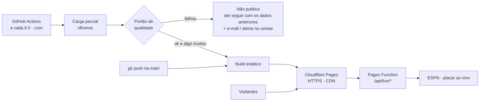

# Publicação na internet: grátis, automática e sem servidor

O site fica no **Cloudflare Pages**. O **GitHub Actions** atualiza os dados sozinho a cada 6 horas, confere a qualidade e republica. Não há servidor para manter, atualizar ou pagar.

> Tempo: cerca de 20 minutos na primeira vez. Depois, nada a fazer.

---

## Como funciona



| Parte | Serviço | Custo |
|---|---|---|
| Hospedagem, HTTPS e CDN | Cloudflare Pages (sem limite de tráfego) | R$ 0, sem cartão |
| Placar ao vivo | Pages Functions (`functions/api/live/`), com cache de 30–60 s na borda | R$ 0 (até 100 mil acessos/dia) |
| Atualização automática (cron) | GitHub Actions: `.github/workflows/publish.yml` | R$ 0 |
| Eventos e histórico | Aba **Actions** do GitHub, com o resumo de cada execução (o que mudou, qualidade, se publicou) | R$ 0 |
| Alertas | E-mail automático do GitHub + celular (ntfy, opcional) | R$ 0 |

**O que muda em relação a rodar com servidor:**
- A área `/admin` e a API REST completa (`/api/teams`…) não existem nesta versão.
- O papel do painel passa para a aba **Actions**. Os dados ficam abertos em `/data/*.json`.
- Todo o resto funciona igual, inclusive o placar ao vivo.

---

## Passo 1 — Conferir o repositório

- `.env`, `/data/`, `/data-raw/` e `/ops/` já estão no `.gitignore`. Nunca suba tokens ou o `.env`.
- Nesta forma de publicar não existe `ADMIN_TOKEN`. Os únicos segredos ficam guardados no GitHub (passo 3).

## Passo 2 — Testar no seu computador

```powershell
npm run qa
npm run build:static
```

Os dois precisam terminar sem erro. O `build:static` gera a pasta `dist/` com o site e os dados.

## Passo 3 — Cloudflare: conta e token

1. Crie a conta grátis em **dash.cloudflare.com/sign-up**. Não pede cartão.
2. **Account ID:** menu **Workers & Pages** → copie o *Account ID* na coluna da direita.
3. **Token:** clique no ícone do perfil → **My Profile → API Tokens → Create Token → Create Custom Token**:
   - *Permissions*: **Account** · **Cloudflare Pages** · **Edit** (só essa).
   - *Account Resources*: a sua conta.
   - Crie e **copie o token** (ele só aparece uma vez).

> ⚠️ **Não** use o botão *Connect to Git* da Cloudflare. O build feito por lá não teria os dados, que são gerados no GitHub Actions. A publicação é feita pelo workflow, que já cria o projeto sozinho.

## Passo 4 — GitHub: segredos e variáveis

No repositório → **Settings → Secrets and variables → Actions**.

Aba **Secrets** → *New repository secret*:

| Nome | Valor |
|---|---|
| `CLOUDFLARE_API_TOKEN` | o token do passo 3 |
| `CLOUDFLARE_ACCOUNT_ID` | o Account ID do passo 3 |
| `NTFY_URL` *(opcional)* | `https://ntfy.sh/<um-nome-dificil>`, para alertas no celular (passo 8) |

Aba **Variables** → *New repository variable* (opcionais):

| Nome | Valor |
|---|---|
| `CF_PAGES_PROJECT` | nome do projeto; o padrão é `end-zone-analytics` |
| `SITE_URL` | o endereço final (ex.: `https://end-zone-analytics.pages.dev`), usado no `sitemap.xml` |

## Passo 5 — Primeira publicação

1. GitHub → aba **Actions** → **Atualizar dados e publicar** → **Run workflow** → tipo **full** → *Run*.
2. Leva de 3 a 6 minutos. Ao terminar, abra a execução: o **resumo** mostra a qualidade dos dados e se o site foi publicado.
3. O endereço principal é `https://<nome-do-projeto>.pages.dev` (ex.: `https://end-zone-analytics.pages.dev`). Ele aparece em **Workers & Pages → seu projeto** no painel da Cloudflare. O log do passo *Publicar no Cloudflare Pages* mostra também um endereço exclusivo de cada publicação. Se o endereço principal for diferente do esperado, atualize a variável `SITE_URL`.

## Passo 6 — Testar o endereço público

- [ ] Início, Temporada, Times, Jogadores, Comparador e Super Bowl abrem e mostram dados
- [ ] Link direto funciona (ex.: abrir `…/teams/kc` em uma aba nova)
- [ ] Logos, gráficos, seletor de temporada, modo Iniciante/Expert e tema claro/escuro
- [ ] Placar ao vivo em dia de jogo (selo **Ao vivo** nos cards)
- [ ] No celular: menu, tabelas e cards de jogos
- [ ] `…/data`: fontes, data da última atualização e qualidade

## Passo 7 — Atualização automática (já ligada)

| Quando | O que acontece |
|---|---|
| A cada 6 h (00:17, 06:17, 12:17 e 18:17 UTC, ou seja, 21:17, 03:17, 09:17 e 15:17 em Brasília) | Carga parcial → portão de qualidade → **republica só se algum dado mudou** |
| Todo `git push` na `main` | Testes → build → publica a nova versão do código |
| Quando você quiser | Aba **Actions** → *Run workflow* (parcial ou completa) |

- **Nada muda nas fontes?** Nada é republicado. A execução fica registrada como "Sem mudanças nas fontes".
- **Falhou** (fonte fora do ar, qualidade reprovada)? O site continua no ar com os dados anteriores e você é avisado.
- Entre uma execução e outra, os dados ficam guardados no cache do Actions. Assim, cada carga parcial baixa só o que mudou.
- O GitHub fornece um token automático: o erro **HTTP 403 (limite da API do GitHub) não acontece aqui**.
- **Mais atualizações em dia de jogo?** Em `.github/workflows/publish.yml`, acrescente outra linha em `schedule`, por exemplo `- cron: '47 * * * 0,1,2,4,5'`. Ela roda de hora em hora de domingo a sexta e cobre os jogos de domingo, segunda e quinta, que terminam de madrugada no horário UTC. Os horários do cron são em UTC. Em repositório privado, isso consome mais minutos (veja os limites abaixo).

## Passo 8 — Alertas e eventos

- **E-mail:** o GitHub avisa automaticamente quando uma execução falha. Confira em github.com → *Settings → Notifications → Actions*.
- **Celular (opcional):**
  1. Instale o app **ntfy** e assine um tópico difícil de adivinhar (ex.: `eza-alertas-7f3k9q2m`).
  2. Crie o segredo `NTFY_URL` (passo 4).
  3. Teste com: `curl -d "teste" https://ntfy.sh/eza-alertas-7f3k9q2m`.
- **Histórico:** cada execução na aba **Actions** tem um resumo com o que mudou (ex.: "Calendário e resultados: +16 linhas"), a qualidade e se publicou.

## Passo 9 — Domínio próprio (opcional)

Comece com o endereço `*.pages.dev`, que é grátis e definitivo. Se depois comprar um domínio, que é um custo à parte:
1. Cloudflare → **Workers & Pages → seu projeto → Custom domains → Set up a domain**.
2. Atualize a variável `SITE_URL`.

O certificado HTTPS é automático.

---

## Limites do plano grátis (com folga para este projeto)

| Recurso | Uso esperado |
|---|---|
| Minutos do GitHub Actions | Repositório público: ilimitado. Privado: 2.000 min/mês; cada execução leva de 1,5 a 5 min, o que dá ~200–500 min/mês |
| Publicações no Cloudflare Pages | Só quando algo muda: até ~120 por mês |
| Pages Functions (placar ao vivo) | 100 mil acessos/dia, e o cache de 30–60 s na borda reduz muito esse número |
| Tamanho do site | ~35 MB em ~180 arquivos; o limite é 25 MB **por arquivo** e 20 mil arquivos |
| Cache de dados do Actions | Bem abaixo do limite de 10 GB; é renovado a cada execução |

> **Repositório sem commits por 60 dias:** em repositórios públicos, o GitHub pausa os workflows agendados e avisa por e-mail. Para reativar, vá em **Actions → Atualizar dados e publicar → Enable workflow**. Qualquer commit também evita a pausa.

## Problemas comuns

| Sintoma | Solução |
|---|---|
| Falha em *Publicar no Cloudflare Pages* com "Authentication error" | Token sem a permissão **Cloudflare Pages · Edit**, ou Account ID errado (passos 3 e 4) |
| Falha no *Portão de qualidade* | Os dados novos da fonte têm um problema real. O site segue com os dados anteriores; veja o detalhe no log e rode de novo mais tarde |
| Falha na *Carga de dados* | Fonte (nflverse/GitHub) fora do ar. A próxima execução agendada tenta de novo |
| Página em branco ou 404 ao abrir um link direto | Confirme que publicou a pasta `dist` gerada por `npm run build:static`, e não por `npm run build` |
| Placar ao vivo não aparece | Fora do horário de jogo é normal. Em dia de jogo, teste `…/api/live/scoreboard`: deve responder com JSON |
| Quero forçar a recarga de tudo | Actions → *Run workflow* → **full** |

## Segurança

- [ ] Token da Cloudflare só com **Cloudflare Pages · Edit**
- [ ] Segredos só em *GitHub → Secrets* (nunca no código)
- [ ] Verificação em duas etapas no GitHub e na Cloudflare
- [ ] Cabeçalhos de segurança (CSP, HSTS, nosniff, proteção contra embutir o site em outras páginas) vêm de `public/_headers`
- [ ] Nada administrativo é publicado: o build estático exclui o `/admin`

---

Quer o painel `/admin` e a API REST completa online? Veja o guia alternativo com servidor próprio: [PUBLICACAO_SERVIDOR.md](PUBLICACAO_SERVIDOR.md).
