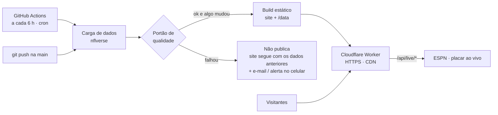

# Publicação na internet: grátis, automática e sem servidor

O site roda num **Cloudflare Worker**. Páginas e dados são arquivos servidos pela CDN da Cloudflare; o código só executa no placar ao vivo. Quem atualiza os dados e publica é o **GitHub Actions**: a cada 6 horas ele baixa os dados novos, confere a qualidade e republica. Não há servidor para manter nem pagar.

> **Site no ar:** <https://end-zone-analytics.insanogamerj.workers.dev>
> Tempo para configurar do zero: cerca de 20 minutos. Depois, nada a fazer.

**Índice:**

1. [Como funciona](#como-funciona)
2. [Passo a passo](#passo-1--desligar-o-build-automático-da-cloudflare)
3. [Verificação depois de publicar](#passo-6--verificar-se-está-tudo-certo)
4. [Atualização automática](#passo-7--atualização-automática-já-ligada)
5. [Alertas](#passo-8--alertas-e-eventos)
6. [Limites](#limites-do-plano-grátis-com-folga)
7. [Problemas comuns](#problemas-comuns)
8. [Segurança](#segurança)

---

## Como funciona



| Parte | Onde fica no projeto | Custo |
|---|---|---|
| Site, dados, HTTPS e CDN | Cloudflare Workers com *static assets*: `wrangler.jsonc` | R$ 0, sem cartão |
| Placar ao vivo | O próprio Worker (`worker/index.ts`), com cache de 30–60 s | R$ 0 (até 100 mil chamadas/dia; páginas e dados não contam) |
| Atualização automática (cron) | GitHub Actions: `.github/workflows/publish.yml` | R$ 0 |
| Cabeçalhos de segurança | `public/_headers` | — |
| Eventos e histórico | Aba **Actions** do GitHub, com o resumo de cada execução (`scripts/publish-summary.mjs`) | R$ 0 |
| Alertas | E-mail automático do GitHub + celular (ntfy, opcional) | R$ 0 |

**O que muda em relação a rodar com servidor:**
- A área `/admin` e a API REST completa (`/api/teams`…) não existem nesta versão.
- O papel do painel passa para a aba **Actions**. Os dados ficam abertos em `/data/*.json`.
- Todo o resto funciona igual, inclusive o placar ao vivo.
- Quer o `/admin` online? Veja [PUBLICACAO_SERVIDOR.md](PUBLICACAO_SERVIDOR.md).

> ### ⚠️ Por que o site aparece sem dados com o "Connect to Git" da Cloudflare
> Os dados (`/data`) **não ficam no GitHub**: são gerados pelo pipeline. Se a Cloudflare faz o build sozinha a partir do repositório, publica só o site, sem dados. O resultado são páginas com "Sem jogos para esta seleção" e "A temporada ainda não tem jogos disputados", e `…/data/manifest.json` abre a página do site em vez de um JSON.
> **Quem publica é o GitHub Actions**, que gera os dados antes do build. Por isso o build automático da Cloudflare precisa ficar **desligado** (passo 1).

---

## Passo 1 — Desligar o build automático da Cloudflare

Só se você já tiver usado o *Connect to Git*.

Cloudflare → **Workers & Pages → end-zone-analytics → Settings → Build → Git repository → Disconnect**.

O Worker e o endereço `*.workers.dev` continuam existindo. Só deixa de haver um segundo publicador sobrescrevendo o site sem dados.

> Ainda não criou nada na Cloudflare? Pule este passo: a primeira execução do workflow cria o Worker sozinha.

## Passo 2 — Testar no seu computador (opcional, recomendado)

```powershell
npm run qa
npm run build:static
npx wrangler@4 dev --port 8788
```

Abra `http://localhost:8788`: deve aparecer o site completo, com dados e placar. Esse é exatamente o que vai para a Cloudflare. Feche com `Ctrl+C`.

## Passo 3 — Cloudflare: token e Account ID

### Token

1. Clique no ícone do perfil → **My Profile → API Tokens → Create Token**.
2. Escolha o modelo **Edit Cloudflare Workers** → *Use template*.
3. Em *Account Resources*, selecione a sua conta. Em *Zone Resources*, *All zones* pode ficar.
4. **Continue to summary → Create Token** e **copie o token** (começa com `cfut_…`). Ele só aparece uma vez.

> 🔒 **O token é uma senha.** Não mande print nem cole em chat. Se ele vazar, em **View all API tokens → ⋯ → Roll** você gera um novo (o antigo deixa de valer) e atualiza o segredo no GitHub.

### Account ID

É o código de 32 caracteres que aparece **no endereço do painel** da Cloudflare:

```
https://dash.cloudflare.com/0123456789abcdef0123456789abcdef/workers/...
                            └──────────── Account ID ────────────┘
```

Também aparece em **Workers & Pages → Account details**, na coluna da direita.

## Passo 4 — GitHub: segredos

No repositório → **Settings → Secrets and variables → Actions → aba Secrets → New repository secret**. Crie **um de cada vez**:

| Name (exatamente assim) | Secret (valor) |
|---|---|
| `CLOUDFLARE_API_TOKEN` | o token do passo 3 (`cfut_…`) |
| `CLOUDFLARE_ACCOUNT_ID` | o Account ID do passo 3 |
| `NTFY_URL` *(opcional)* | `https://ntfy.sh/<um-nome-dificil>`, para alertas no celular (passo 8) |

> **Erro "Secret names can only contain alphanumeric characters or underscores"?** O campo **Name** recebeu algo além de letras, números e `_`. Os casos mais comuns:
> - espaço no começo ou no fim do nome;
> - hífen no lugar do underscore;
> - o token colado no campo Name em vez do campo **Secret**.

**Variables** (opcional), na aba ao lado:

| Name | Valor |
|---|---|
| `SITE_URL` | `https://end-zone-analytics.<sua-conta>.workers.dev`, usado para gerar o `sitemap.xml` |

## Passo 5 — Publicar

Faça o commit e o push. O **push na `main` já dispara a publicação**:

```powershell
git add -A
git commit -m "Publicação no Cloudflare"
git push
```

Para disparar manualmente: **Actions → Atualizar dados e publicar → Run workflow → `full` → Run workflow**.

- A primeira execução leva de 3 a 6 minutos (baixa todos os dados). As seguintes, de 1 a 3.
- Os passos da execução são, em ordem:
  1. Testes do código
  2. Restaurar dados
  3. Carga de dados
  4. Portão de qualidade
  5. Build
  6. Publicar no Cloudflare
  7. Resumo
- No fim, o **resumo** mostra a qualidade dos dados e "🚀 publicado no Cloudflare".

> O nome do Worker vem do `wrangler.jsonc` (`"name": "end-zone-analytics"`). Ele precisa ser igual ao do Worker que já existe; assim a publicação substitui a versão sem dados.

## Passo 6 — Verificar se está tudo certo

### No terminal (PowerShell ou Git Bash)

```bash
curl -s -o /dev/null -w "%{http_code} %{content_type}\n" https://end-zone-analytics.insanogamerj.workers.dev/data/manifest.json
curl -s -o /dev/null -w "%{http_code} %{content_type}\n" https://end-zone-analytics.insanogamerj.workers.dev/api/live/scoreboard
```

| Endereço | Esperado | Se vier diferente |
|---|---|---|
| `/data/manifest.json` | `200 application/json` | `text/html` = publicado sem dados (passos 1 e 5) |
| `/data/games/2026.json` | `200 application/json` | idem |
| `/api/live/scoreboard` | `200 application/json` | `text/html` = Worker antigo; rode o workflow de novo |
| `/teams/kc` | `200 text/html` (página do time) | 404 = `wrangler.jsonc` não foi usado |
| `/api/admin/session` | `404 application/json` | Correto: não há admin no site público |

### No navegador

- [ ] Início mostra os jogos da semana, a classificação, os destaques e "Dados atualizados há…"
- [ ] O link direto funciona (ex.: `…/teams/kc` em uma aba nova)
- [ ] Logos, gráficos, seletor de temporada, Iniciante/Expert e tema claro/escuro funcionam
- [ ] Em dia de jogo, os cards mostram o selo **Ao vivo**
- [ ] No celular: menu, tabelas e cards de jogos
- [ ] `…/data`: fontes, data da última atualização e qualidade (ex.: 18/18)

## Passo 7 — Atualização automática (já ligada)

| Quando | O que acontece |
|---|---|
| A cada 6 h (00:17, 06:17, 12:17 e 18:17 UTC, ou seja, 21:17, 03:17, 09:17 e 15:17 em Brasília) | Carga parcial → portão de qualidade → **republica só se algum dado mudou** |
| Todo `git push` na `main` | Testes → dados → build → publica |
| Quando você quiser | **Actions → Run workflow** (`partial` ou `full`) |

- **Nada muda nas fontes?** Nada é republicado. O resumo da execução mostra "Sem mudanças nas fontes".
- **Algo falhou?** O site continua no ar com os dados anteriores e você é avisado.
- Os dados ficam guardados no cache do Actions entre as execuções. Assim, cada carga parcial baixa só o que mudou.
- O GitHub fornece um token automático: o erro **HTTP 403** (limite da API do GitHub) não acontece aqui.
- **Mais atualizações em dia de jogo?** Em `publish.yml`, acrescente em `schedule` a linha `- cron: '47 * * * 0,1,2,4,5'`. Ela roda de hora em hora de domingo a sexta. Os horários do cron são em UTC; em repositório privado, consome mais minutos.

## Passo 8 — Alertas e eventos

- **E-mail:** o GitHub avisa quando uma execução falha. Confira em github.com → *Settings → Notifications → Actions*.
- **Celular (opcional):**
  1. Instale o app **ntfy** e assine um tópico difícil de adivinhar.
  2. Crie o segredo `NTFY_URL`.
  3. Teste com `curl -d "teste" https://ntfy.sh/<tópico>`.
- **Histórico:** cada execução na aba **Actions** tem um resumo com o que mudou (ex.: "Calendário e resultados: +16 linhas"), a qualidade e se publicou.
- **Placar ao vivo:** Cloudflare → Worker → **Observability** mostra as chamadas e eventuais erros.

## Passo 9 — Domínio próprio (opcional)

O endereço `*.workers.dev` é grátis e definitivo. Com um domínio próprio, que é um custo à parte:
1. Adicione o domínio na Cloudflare.
2. Vá em **Worker → Settings → Domains & Routes → Add → Custom domain**.
3. Atualize a variável `SITE_URL`.

O certificado HTTPS é automático.

---

## Limites do plano grátis (com folga)

| Recurso | Uso esperado |
|---|---|
| Minutos do GitHub Actions | Repositório público: ilimitado. Privado: 2.000 min/mês; cada execução leva de 1,5 a 5 min, o que dá ~200–500 min/mês |
| Requisições do Worker | Só o placar ao vivo conta (100 mil/dia, com cache); páginas e dados são arquivos estáticos e não contam |
| Tamanho do site | ~35 MB em ~290 arquivos; o limite é 25 MB **por arquivo** e 20 mil arquivos |
| Cache de dados do Actions | Bem abaixo do limite de 10 GB |

> **Repositório sem commits por 60 dias:** em repositórios públicos, o GitHub pausa os workflows agendados e avisa por e-mail. Para reativar, vá em **Actions → Atualizar dados e publicar → Enable workflow**.

## Problemas comuns

| Sintoma | Causa e solução |
|---|---|
| Site sem dados ("Sem jogos para esta seleção") | Publicado pelo build da Cloudflare, que não tem os dados. Faça o passo 1 e rode o workflow (passo 5) |
| `…/data/manifest.json` abre a página do site | Mesmo caso acima |
| Placar ao vivo devolve HTML | O Worker publicado é anterior ao `worker/index.ts`. Rode o workflow de novo |
| Falha em *Publicar no Cloudflare* com "Authentication error" | Token sem o modelo **Edit Cloudflare Workers**, Account ID errado ou segredo com nome diferente (passos 3 e 4) |
| Erro ao salvar o segredo no GitHub ("Secret names can only contain…") | Nome com espaço/hífen, ou o token colado no campo Name (passo 4) |
| CI falha com "Cannot find module '../data/…'" | Arquivos de `src/data/` fora do git. O `.gitignore` precisa usar `/data/` (com barra inicial), não `data/` (já corrigido no projeto) |
| Falha no *Portão de qualidade* | Os dados novos da fonte têm um problema real. O site segue com os dados anteriores; veja o detalhe no log e rode de novo mais tarde |
| Falha na *Carga de dados* | Fonte (nflverse/GitHub) fora do ar. A próxima execução tenta de novo |
| Console do navegador: "Loading the font … violates Content Security Policy" | As fontes do site são do próprio domínio e são permitidas. Costuma vir de **extensões do navegador**; teste numa janela anônima |
| O workflow aparece como "skipped" (pulado) | A variável `DEPLOY_TARGET` está como `server`. Apague-a para voltar ao Cloudflare |
| Quero recarregar tudo | Actions → Run workflow → **full** |

## Segurança

- [ ] Build automático da Cloudflare desligado (só o GitHub Actions publica)
- [ ] Token da Cloudflare criado pelo modelo **Edit Cloudflare Workers** e guardado só em *GitHub → Secrets*; faça o *Roll* se ele tiver aparecido em print ou chat
- [ ] Verificação em duas etapas no GitHub e na Cloudflare
- [ ] Cabeçalhos de segurança (CSP, HSTS, nosniff, proteção contra embutir o site em outras páginas) vêm de `public/_headers`
- [ ] Nada administrativo é publicado: o build estático exclui o `/admin`, e o Worker responde 404 para o resto de `/api/*`
