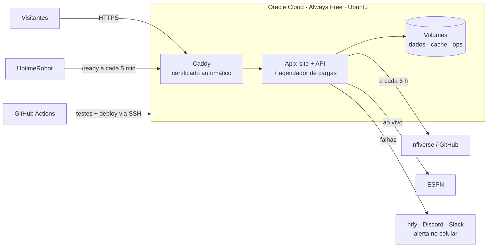

# Publicação em servidor próprio (alternativa), passo a passo

> **Caminho recomendado:** [PUBLICACAO.md](PUBLICACAO.md) — Cloudflare Pages + GitHub Actions, sem servidor para manter. Use este guia só se quiser o painel `/admin` e a API REST completa online.

Guia para colocar o **End Zone Analytics completo** no ar: site, API, placar ao vivo, área administrativa, cargas automáticas, logs e alertas no celular. Tudo em serviços gratuitos.

> Tempo estimado: 1 h a 1 h 30 na primeira vez. Depois, cada atualização é automática.

---

## 0. Visão geral



| Peça | Serviço | Custo |
|---|---|---|
| Servidor | Oracle Cloud **Always Free** (VM ARM até 4 CPUs e 24 GB de RAM) | R$ 0 (pede cartão só para verificação) |
| Domínio + HTTPS | **DuckDNS** (subdomínio grátis) + Caddy (Let's Encrypt) | R$ 0 |
| Cargas de dados | Agendador interno da aplicação (parcial a cada 6 h, completa semanal) | R$ 0 |
| Logs, jobs e eventos | Área `/admin` (protegida por token) | R$ 0 |
| Alertas no celular | **ntfy.sh** (ou Discord/Slack) | R$ 0 |
| Monitoramento externo | **UptimeRobot** | R$ 0 |
| Testes e deploy automático | **GitHub Actions** | R$ 0 |

O que o projeto já traz pronto para isso: `Dockerfile`, `docker-compose.yml`, `deploy/Caddyfile`, `deploy/setup-server.sh`, `deploy/update.sh`, `deploy/backup.sh` e `.github/workflows/ci.yml`.

---

## 1. Antes de começar

- Conta no **GitHub** com o repositório do projeto (`main` atualizada).
- No seu computador: terminal com `ssh` (Windows 10/11 já tem no PowerShell).
- Gere uma chave SSH só para o servidor:

```powershell
ssh-keygen -t ed25519 -f $HOME\.ssh\eza -C "end-zone-analytics"
```

Isso cria `eza` (privada — nunca compartilhe) e `eza.pub` (pública — vai para a Oracle).

---

## 2. Criar o servidor na Oracle Cloud

1. Crie a conta em **cloud.oracle.com** → *Start for free*.
   - **Região inicial:** escolha **Brazil East (São Paulo)** ou **Brazil Southeast (Vinhedo)**. Ela **não pode ser trocada depois** e é onde ficam os recursos gratuitos.
   - O cartão é só para verificação; recursos *Always Free* não são cobrados.
2. Menu → **Compute → Instances → Create instance**.
   - **Name:** `end-zone-analytics`
   - **Image:** *Canonical Ubuntu 24.04* (aarch64).
   - **Shape:** *Ampere* → **VM.Standard.A1.Flex** → **2 OCPUs e 12 GB** (sobra para crescer; o limite grátis é 4 OCPUs/24 GB no total).
   - **Networking:** crie uma VCN nova com **sub-rede pública** e marque *Assign a public IPv4 address*.
   - **SSH keys:** *Upload public key files* → selecione `eza.pub`.
   - **Boot volume:** 50 GB (padrão) é suficiente.
3. Clique em **Create** e anote o **Public IP address**.

> **"Out of capacity"?** É comum no plano grátis. Tente outro *Availability Domain*, tente mais tarde, ou use o shape **VM.Standard.E2.1.Micro** (1 GB de RAM — funciona; o script cria 2 GB de swap).

### Liberar as portas 80 e 443 na rede da Oracle

Instância → **Subnet** → **Security List** padrão → **Add Ingress Rules**:

| Source CIDR | Protocolo | Porta de destino |
|---|---|---|
| `0.0.0.0/0` | TCP | 80 |
| `0.0.0.0/0` | TCP | 443 |
| `0.0.0.0/0` | UDP | 443 |

(A porta 22/SSH já vem liberada.)

> **Evite que a Oracle recupere a VM ociosa:** instâncias Always Free com uso muito baixo por 7 dias podem ser reclamadas. Para evitar, faça *Upgrade to Pay As You Go* em **Billing** — continua grátis dentro dos limites Always Free — e crie um **Budget** de US$ 1 com alerta por e-mail como garantia.

---

## 3. Domínio grátis com HTTPS (DuckDNS)

1. Entre em **duckdns.org** (login com GitHub/Google).
2. Crie um subdomínio, ex.: `endzone-analytics` → fica `endzone-analytics.duckdns.org`.
3. No campo **current ip**, coloque o IP público da VM e clique em **update ip**.

> Tem domínio próprio? Crie um registro **A** apontando para o IP da VM e use esse domínio no passo 5.

---

## 4. Preparar o servidor

No seu computador:

```powershell
ssh -i $HOME\.ssh\eza ubuntu@SEU_IP
```

No servidor:

```bash
git clone https://github.com/lucasllimati/end-zone-analytics.git
cd end-zone-analytics
bash deploy/setup-server.sh
exit
```

O script atualiza o sistema e liga as atualizações de segurança automáticas. Ele também:
- instala Docker e fail2ban;
- configura o firewall (só SSH, 80 e 443), incluindo a regra extra que as imagens da Oracle exigem;
- desativa login por senha e o login como root;
- cria a swap.

Entre de novo (para valer o grupo `docker`):

```bash
ssh -i ~/.ssh/eza ubuntu@SEU_IP
cd end-zone-analytics
```

> Repositório **privado**? Antes do `git clone`, gere uma chave no servidor (`ssh-keygen -t ed25519`) e cadastre o `.pub` em GitHub → repositório → *Settings → Deploy keys* (somente leitura). Depois clone com `git clone git@github.com:lucasllimati/end-zone-analytics.git`.

---

## 5. Configurar o `.env` (segredos)

```bash
cp .env.example .env
openssl rand -hex 32        # copie o resultado para ADMIN_TOKEN
nano .env
chmod 600 .env
```

Preencha:

| Variável | Valor |
|---|---|
| `ADMIN_TOKEN` | o valor gerado acima (é a "senha" do `/admin`; guarde num gerenciador de senhas) |
| `GITHUB_TOKEN` | GitHub → *Settings → Developer settings → Fine-grained tokens* → *Public repositories (read-only)*, **sem nenhuma permissão extra**. Sobe o limite de 60 para 5.000 consultas/hora (fim do erro 403) |
| `DOMAIN` | `endzone-analytics.duckdns.org` |
| `ACME_EMAIL` | seu e-mail (avisos do certificado) |
| `SYNC_PARTIAL_EVERY_HOURS` | `6` (carga parcial a cada 6 h) |
| `SYNC_FULL_WEEKDAY` / `SYNC_FULL_HOUR_UTC` | `2` / `7` (completa às terças, 04:00 de Brasília) |
| `ALERT_WEBHOOK_URL` | veja o passo 8 |

Não mexa em `HOST` e `API_PORT` — o `docker-compose.yml` já define.

---

## 6. Subir a aplicação

```bash
docker compose up -d --build
docker compose logs -f app
```

- O primeiro build leva de 3 a 8 minutos.
- Na primeira execução, a aplicação faz a **carga completa** dos dados (1–3 min) e depois começa a responder. Saia dos logs com `Ctrl+C`.
- O Caddy emite o certificado HTTPS sozinho em menos de 1 minuto.

Teste no navegador:

- `https://endzone-analytics.duckdns.org` → site
- `https://endzone-analytics.duckdns.org/ready` → `{"status":"ready", …}`

---

## 7. Área administrativa, jobs e eventos

Abra `https://SEU_DOMINIO/admin` e entre com o `ADMIN_TOKEN`.

| Aba | O que você acompanha |
|---|---|
| **Visão geral** | API, arquivos publicados, última publicação × última tentativa, qualidade, **Cargas automáticas: Ativas** (com a próxima execução), **Alertas externos**, token do GitHub |
| **Fontes e cargas** | Verificar dados novos; rodar carga parcial (por fonte/temporada) ou completa (com confirmação); acompanhar o log do job; execuções recentes (*Painel*, *Terminal* ou *Agendada*) |
| **Logs e alertas** | Eventos por severidade (informativo, atenção, erro, crítico), componente, job, ação recomendada e se já foi resolvido |
| **Histórico** | Só as publicações em que **os dados mudaram** (ex.: "Calendário e resultados · +16 linhas"); verificações sem mudança aparecem agrupadas |

Como as cargas funcionam:
- Rodam **dentro da aplicação**, sem cron externo.
- Só uma carga roda por vez.
- Se uma falhar, o site continua com os dados anteriores e um alerta é registrado (e enviado ao celular).
- Uma carga sem mudanças **não cria nova publicação**.

A sessão do admin expira em 8 h. Em produção não existe acesso sem token.

---

## 8. Alertas no celular (ntfy, grátis)

1. Instale o app **ntfy** (Android/iOS).
2. Escolha um tópico difícil de adivinhar, ex.: `eza-alertas-7f3k9q2m`, e assine no app.
3. No `.env`:

```bash
ALERT_WEBHOOK_URL=https://ntfy.sh/eza-alertas-7f3k9q2m
ALERT_WEBHOOK_FORMAT=ntfy
ALERT_MIN_SEVERITY=warning
```

4. Aplique e teste:

```bash
docker compose up -d
curl -d "Teste de alerta do End Zone Analytics" https://ntfy.sh/eza-alertas-7f3k9q2m
```

- **O que chega no celular:** cargas que falharam, fontes indisponíveis, alertas de qualidade, tentativas de login recusadas.
- **Quer receber também as cargas bem-sucedidas?** Use `ALERT_MIN_SEVERITY=info`.
- **Prefere Discord?** Copie a URL do webhook do canal e use `ALERT_WEBHOOK_FORMAT=discord`. No Slack, use `slack`.

---

## 9. Monitoramento externo (UptimeRobot)

Em **uptimerobot.com** (grátis), crie um monitor:
- **Tipo:** HTTP(s) — keyword
- **URL:** `https://SEU_DOMINIO/ready`, palavra-chave `ready`
- **Intervalo:** 5 minutos

Você recebe e-mail se o site cair. A página de status pública do UptimeRobot é opcional.

---

## 10. Backups

Os dados publicados podem ser recriados com uma carga completa. O que vale guardar é o **log operacional** (execuções, alertas, auditoria) e o `.env`:

```bash
crontab -e
# adicione:
0 4 * * * bash /home/ubuntu/end-zone-analytics/deploy/backup.sh >> /home/ubuntu/backup.log 2>&1
```

Os backups ficam em `~/backups` (os 14 mais recentes). Também dá para ativar a política de backup do *Boot Volume* na Oracle (o plano grátis inclui 5 backups).

---

## 11. Deploy automático a cada push (GitHub Actions)

O workflow `.github/workflows/ci.yml` roda typecheck, testes, ortografia, build e auditoria de dependências em todo push e pull request. Para ele também **publicar no servidor**:

1. No servidor, crie uma chave só para o deploy:

```bash
ssh-keygen -t ed25519 -f ~/.ssh/deploy -N "" -C "github-actions"
cat ~/.ssh/deploy.pub >> ~/.ssh/authorized_keys
cat ~/.ssh/deploy          # copie a chave PRIVADA (para o segredo abaixo)
```

2. No GitHub → repositório → *Settings*:
   - *Secrets and variables → Actions → Secrets*: `SSH_HOST` (IP ou domínio), `SSH_USER` (`ubuntu`), `SSH_KEY` (a chave privada do passo anterior).
   - *Variables*: `DEPLOY_ENABLED` = `true`.
   - *Environments → production* (opcional): marque *Required reviewers* para aprovar cada deploy manualmente.

A partir daí:
1. Você dá `git push`.
2. O Actions testa o código.
3. Se tudo passar, entra no servidor e roda `deploy/update.sh`.
4. A aplicação é reconstruída e o deploy só termina com sucesso quando `/ready` responde.

Os dados não se perdem: eles ficam nos volumes do Docker.

Sem o deploy automático, publique manualmente com `bash deploy/update.sh` no servidor.

---

## 12. Operação do dia a dia

| Tarefa | Como |
|---|---|
| Ver jobs, falhas e alertas | `/admin` → *Logs e alertas* |
| Forçar uma carga agora | `/admin` → *Fontes e cargas* |
| Publicar nova versão do código | `git push` (com deploy automático) ou `bash deploy/update.sh` |
| Ver logs brutos | `docker compose logs --tail=200 app` |
| Reiniciar | `docker compose restart app` |
| Carga completa pelo terminal | `docker compose exec app node_modules/.bin/tsx server/etl/cli.ts full` |
| Espaço em disco | `df -h` e `docker system df` |
| Trocar o token do admin | edite `ADMIN_TOKEN` no `.env` e rode `docker compose up -d` (derruba as sessões abertas) |

---

## 13. Checklist de segurança

- [ ] `ADMIN_TOKEN` longo e aleatório, guardado fora do servidor
- [ ] `.env` com `chmod 600` e **fora do git** (já está no `.gitignore`)
- [ ] SSH só com chave; login como root desativado (feito pelo `setup-server.sh`)
- [ ] Firewall: somente 22, 80 e 443 (Oracle Security List + ufw)
- [ ] Atualizações automáticas de segurança ativas
- [ ] API não exposta diretamente (o Compose só publica o Caddy)
- [ ] HTTPS ativo; HSTS, CSP e demais cabeçalhos vêm da aplicação
- [ ] Alertas chegando no celular (teste do passo 8)
- [ ] UptimeRobot monitorando `/ready`
- [ ] Backup diário agendado
- [ ] Verificação em duas etapas na Oracle, no GitHub e no DuckDNS (conta Google/GitHub)

---

## 14. Problemas comuns

| Sintoma | Causa e solução |
|---|---|
| O site não abre (tempo esgotado) | Portas 80/443 não liberadas na **Security List** da Oracle (passo 2) ou o `setup-server.sh` não rodou |
| Erro de certificado | O DNS ainda não aponta para o IP (confira no DuckDNS) ou a porta 80 está fechada. Veja `docker compose logs caddy` |
| `502 Bad Gateway` logo após subir | Normal durante a primeira carga completa (1–3 min). Acompanhe com `docker compose logs -f app` |
| Alerta "Limite de consultas da API do GitHub (HTTP 403)" | `GITHUB_TOKEN` ausente ou inválido no `.env`. Corrija e rode `docker compose up -d` |
| "Cargas automáticas: Desligadas" no admin | `SYNC_PARTIAL_EVERY_HOURS` vazio ou `0` no `.env` |
| Não consigo entrar no `/admin` | Token diferente do `.env`; após 5 tentativas em 1 minuto há bloqueio temporário |
| Build lento ou travando na VM de 1 GB | Confirme a swap (`swapon --show`) ou use o shape Ampere A1 |
| "Out of capacity" ao criar a VM | Tente outro *Availability Domain* ou outro horário |
| A VM sumiu ou parou | Recuperação por ociosidade do plano grátis — faça o *upgrade Pay As You Go* (continua grátis) |
