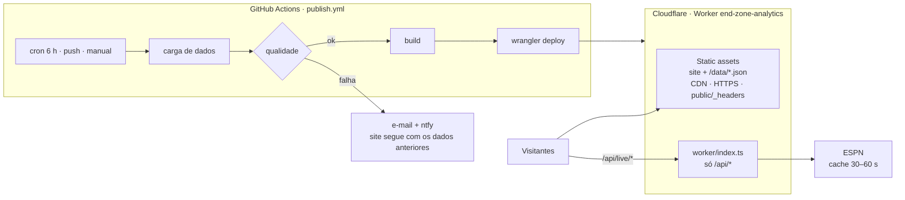

# Servidor no Cloudflare: operação, monitoramento e manutenção

O End Zone Analytics roda **sem servidor tradicional**. O "servidor" é um **Cloudflare Worker**, que serve o site e os dados pela CDN e executa código só no placar ao vivo. Quem faz o trabalho de bastidor (cargas, validação, publicação, histórico e alertas) é o **GitHub Actions**.

> **Site no ar:** <https://end-zone-analytics.nfldata.workers.dev>
> **Configuração inicial (do zero):** [PUBLICACAO.md](PUBLICACAO.md). Este guia cobre o **dia a dia** depois que o site está no ar.

---

## 1. Como o servidor funciona

| Peça | Arquivo | Função |
|---|---|---|
| Configuração do Worker | `wrangler.jsonc` | Nome (`end-zone-analytics`), pasta `dist/`, fallback de rotas para o React, `/api/*` passa pelo código |
| Código do servidor | `worker/index.ts` | `/api/live/scoreboard` e `/api/live/game/{id}` (ESPN, com cache); o resto de `/api/*` responde 404 |
| Cabeçalhos de segurança | `public/_headers` | CSP, HSTS, nosniff, proteção contra embutir o site, cache dos arquivos |
| Publicação e cargas | `.github/workflows/publish.yml` | Cron a cada 6 h, a cada push e manual; portão de qualidade; deploy |
| Resumo de cada execução | `scripts/publish-summary.mjs` | O que mudou, qualidade, se publicou |
| Testes (PRs e branches) | `.github/workflows/ci.yml` | Tipos, testes, ortografia, build e auditoria de dependências |
| Segredos | GitHub → *Settings → Secrets* | `CLOUDFLARE_API_TOKEN`, `CLOUDFLARE_ACCOUNT_ID`, `NTFY_URL` (opcional) |

**O que fica onde:**
- **Código:** GitHub.
- **Dados publicados:** Cloudflare (junto com o site) e cache do GitHub Actions.
- **Dados brutos baixados:** cache do GitHub Actions.

Nada fica no seu computador ou num servidor que você precise manter.

---

## 2. Onde está cada função do "painel administrativo"

No Cloudflare não existe a página `/admin`, porque ela depende de um servidor Node. Todas as funções dela têm um equivalente:

| Você quer… | Onde |
|---|---|
| Ver se o site está saudável | Abra `…/data/manifest.json` (deve ser JSON) e o resumo da última execução na aba **Actions** |
| Ver quando os dados foram atualizados | Rodapé do site, página `/data` ou o resumo da execução ("Publicação atual" e "Fontes verificadas") |
| Ver a qualidade dos dados | Página `/data` (pública) ou o resumo da execução (✅ ok · ⚠️ alertas · ❌ falhas) |
| Verificar se há dados novos | **Actions → Atualizar dados e publicar → Run workflow → `partial`**: verifica e só republica se algo mudou |
| Rodar uma carga completa | **Run workflow → `full`** |
| Ver jobs (execuções) | Aba **Actions**: cada execução mostra a origem (agendada, push ou manual), a duração e o resultado |
| Ver logs de uma carga | Clique na execução → passo **Carga de dados** |
| Logs e alertas | E-mail do GitHub em falhas · ntfy no celular · **Cloudflare → Worker → Observability** (placar ao vivo) |
| Histórico do que mudou | Resumo de cada execução ("O que mudou") e `…/data/history/changes.json` |
| Saber a próxima atualização | Agendadas para 00:17, 06:17, 12:17 e 18:17 UTC (21:17, 03:17, 09:17 e 15:17 em Brasília) |

> **Quer ver o `/admin` funcionando?** Ele existe no ambiente local: `npm run dev` e abra `http://localhost:5173/admin`.

---

## 3. Rotina: o que acontece sozinho

| Quando | O que acontece | Você precisa fazer algo? |
|---|---|---|
| A cada 6 h | Carga parcial → qualidade → publica **só se algo mudou** | Não |
| Fonte fora do ar ou dado reprovado | Nada é publicado; o site segue com os dados anteriores; você recebe e-mail (e ntfy) | Só se repetir por mais de um dia |
| `git push` na `main` | Testes → dados → build → publica a nova versão do código | Não |
| 60 dias sem commits (repositório público) | O GitHub pausa o cron e avisa por e-mail | Clicar em **Enable workflow** |
| Toda segunda-feira | O Dependabot abre PRs com atualizações de dependências e de actions (agrupadas) | Revisar: se o CI do PR passar, **Merge** — a publicação roda testes e `npm audit` de novo |

---

## 4. Operações comuns

| Tarefa | Como |
|---|---|
| Forçar atualização agora | **Actions → Atualizar dados e publicar → Run workflow → `partial`** |
| Recarregar tudo do zero | **Run workflow → `full`** |
| Publicar uma mudança de código | `git push` na `main` |
| Voltar à versão anterior do site (rollback) | Cloudflare → **Workers & Pages → end-zone-analytics → Deployments** → versão anterior → **Rollback**. Ou, no terminal: `npx wrangler@4.144.0 rollback` |
| Ver o placar ao vivo em tempo real (logs) | Cloudflare → Worker → **Observability**. Ou, no terminal: `npx wrangler@4.144.0 login` e depois `npx wrangler@4.144.0 tail` |
| Pausar as atualizações automáticas | **Actions → Atualizar dados e publicar → ⋯ → Disable workflow** (o site continua no ar) |
| Mudar a frequência | Edite `cron` em `.github/workflows/publish.yml` (horário UTC). Exemplo para dias de jogo: `- cron: '47 * * * 0,1,2,4,5'` |
| Trocar o token da Cloudflare | Cloudflare → **My Profile → API Tokens → ⋯ → Roll** → atualize `CLOUDFLARE_API_TOKEN` no GitHub |
| Domínio próprio | Worker → **Settings → Domains & Routes → Add → Custom domain**; atualize a variável `SITE_URL` |
| Ver uso e limites | Cloudflare → Worker → **Metrics**; GitHub → *Settings → Billing → Usage* (minutos do Actions) |
| Testar localmente a versão publicada | `npm run build:static` e `npx wrangler@4.144.0 dev --port 8788` |

---

## 5. Monitoramento (grátis)

1. **Falhas de publicação:** o GitHub envia e-mail automaticamente. Confira em github.com → *Settings → Notifications → Actions*.
2. **Celular (ntfy):** crie o segredo `NTFY_URL` (ver [PUBLICACAO.md](PUBLICACAO.md), passo 8). Chega aviso sempre que uma execução falhar.
3. **Site no ar (UptimeRobot, opcional):** em **uptimerobot.com**, crie um monitor:
   - **Tipo:** *HTTP(s) – Keyword*
   - **URL:** `https://end-zone-analytics.nfldata.workers.dev/data/manifest.json`
   - **Palavra-chave:** `schemaVersion`
   - **Intervalo:** 5 min

   Assim você é avisado se o site cair **ou** se for publicado sem dados.
4. **Placar ao vivo:** Cloudflare → Worker → **Observability** mostra chamadas, erros e tempo de resposta (ativado em `wrangler.jsonc`).

---

## 6. Recuperação e backups

Não há backup a fazer manualmente:

| O que | Onde está a cópia | Como recuperar |
|---|---|---|
| Código | GitHub | `git revert` + push, ou rollback da versão na Cloudflare |
| Versões publicadas do site | Cloudflare guarda as anteriores | **Deployments → Rollback** |
| Dados | Recriados a partir das fontes abertas | **Run workflow → `full`** (~4 min no Actions; o play-by-play é processado em fluxo) |
| Segredos | GitHub Secrets (não dá para lê-los de volta) | Gere de novo na Cloudflare e cadastre outra vez |

---

## 7. Segurança

- [ ] **Só o GitHub Actions publica.** O build automático da Cloudflare (*Settings → Build*) fica desconectado; se ficar ligado, publica o site sem dados.
- [ ] O token da Cloudflare foi criado pelo modelo **Edit Cloudflare Workers** e está só em *GitHub → Secrets*. Faça o *Roll* se ele tiver aparecido em print ou chat.
- [ ] Verificação em duas etapas no **GitHub** e na **Cloudflare**.
- [ ] O site público não tem `/admin` nem login (o build estático exclui), e o Worker responde 404 ao resto de `/api/*`.
- [ ] Os cabeçalhos de segurança vêm de `public/_headers`. Para conferir, rode `curl -sI <endereço>` e veja `content-security-policy` e `strict-transport-security`.
- [ ] `.env`, `/data/`, `/data-raw/`, `/ops/` e `.wrangler/` estão fora do git (`.gitignore`).
- [ ] O site publicado não tem source maps (`curl -s <endereço>/assets/<arquivo>.js | grep -c sourceMappingURL` → 0).
- [ ] O placar ao vivo sai do cache da borda: a segunda chamada a `/api/live/scoreboard` traz `CF-Cache-Status: HIT`.
- [ ] No GitHub, *Settings → Code security*: **Dependabot alerts**, **Dependabot security updates** e **Secret scanning** ligados.
- [ ] Opcional: Cloudflare → *Security → WAF → Rate limiting rules* → uma regra para `/api/` (ex.: 60 requisições em 10 s por IP). O plano grátis permite uma regra.
- [ ] Relatório completo do teste de invasão e checklist de 19 pontos: [SECURITY.md](SECURITY.md).

---

## 8. Custos e limites

Tudo cabe no plano grátis:

| Recurso | Limite grátis | Uso do projeto |
|---|---|---|
| Cloudflare Workers: páginas e dados (static assets) | Sem limite de requisições | Todo o tráfego do site |
| Cloudflare Workers: código (`/api/live/*`) | 100 mil requisições/dia | Só o placar ao vivo, servido do cache da borda (30–60 s) e só para jogos da base |
| Tamanho do site | 20 mil arquivos; 25 MB por arquivo | ~960 arquivos, ~190 MB no total (maior arquivo ≈ 2 MB) |
| GitHub Actions | Repositório público: ilimitado. Privado: 2.000 min/mês | ~250–500 min/mês (2–4 min por execução) |
| Cache do Actions | 10 GB | ~400 MB (estatísticas por jogo e resumos do play-by-play) |

Sem cartão de crédito em nenhum dos dois serviços.

---

## 9. Problemas comuns

| Sintoma | Causa e solução |
|---|---|
| Site sem dados ("Sem jogos para esta seleção") | Foi publicado pelo build automático da Cloudflare. Desconecte em *Settings → Build* e rode **Run workflow → `full`** |
| `…/data/manifest.json` abre a página do site | Mesmo caso acima |
| Placar ao vivo devolve HTML | O Worker publicado é anterior ao `worker/index.ts`. Rode o workflow de novo |
| Falha em *Publicar no Cloudflare* ("Authentication error") | Token sem o modelo **Edit Cloudflare Workers**, token trocado sem atualizar o segredo, ou Account ID errado |
| Falha no *Portão de qualidade* | Dados novos da fonte com problema real. O site segue com os anteriores; veja o log e tente mais tarde |
| Falha na *Carga de dados* | Fonte (nflverse/GitHub) fora do ar. A próxima execução tenta de novo |
| Execução agendada não aparece há dias | Workflow pausado (60 dias sem commits) ou desabilitado. Vá em **Actions → Enable workflow** |
| Site antigo depois de um push | Veja se a execução terminou com "🚀 publicado no Cloudflare". O navegador pode guardar cache por até 5 min nos dados; recarregue com `Ctrl+F5` |
| Console do navegador: "violates Content Security Policy" com fontes | Costuma vir de extensões do navegador; teste numa janela anônima |
| Erro ao salvar segredo no GitHub ("Secret names can only contain…") | Nome com espaço/hífen, ou o token colado no campo Name |

---

## 10. E se um dia precisar do `/admin` e da API completa online?

O painel `/admin` e a API REST (`/api/teams`, `/api/standings`…) precisam de um servidor **Node.js** rodando sem parar. Isso não faz parte do plano grátis da Cloudflare. As opções são:
- um serviço pago de containers;
- um VPS em qualquer provedor.

O projeto já traz `Dockerfile`, `docker-compose.yml` (com HTTPS automático via Caddy) e scripts em `deploy/` para esse caso. A referência técnica está em [DEPLOYMENT.md](DEPLOYMENT.md#hospedagem-própria-avançado). Para o site atual, nada disso é necessário.
