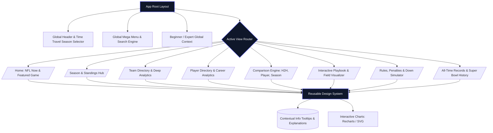

# 🏈 GRIDIRON ATLAS — Enterprise Architecture & Requirements Specification

> **The Complete NFL Data, History & Analytics Platform**  
> *Version:* 3.0.0-PRO  
> *Target Audience:* Beginners, Casual Fans, Fantasy Players, Analysts, Historians, and Data Scientists.  
> *Primary Design Philosophy:* Zero-Blind-Spots, Dual-Mode Learning (Beginner vs. Expert), Immersive UX, Strict Data Provenance, and High-Performance Web Execution.

---

## 1. EXECUTIVE SUMMARY & PRODUCT VISION

**Gridiron Atlas** bridges the gap between raw sports data and human understanding. While platforms like Pro Football Reference or NFL.com cater exclusively to hardcore statisticians or casual news readers, Gridiron Atlas acts as an interactive digital knowledge graph. It connects every entity—from a single snap in 1920 to Patrick Mahomes' latest postseason EPA—with intuitive tooltips, interactive playbooks, dual beginner/expert toggles, and fully transparent metrics calculation models.

### Core Pillars
1. **Data Integrity & Provenance:** Zero synthetic/fake data. Every stat tracks back to verified datasets (`nflverse` / official feeds) with explicit fallback states (`Data Unavailable`).
2. **Dual-Mode Experience (Beginner & Expert):** Real-time toggle on every screen. Beginners see jargon-free explanations, visual aids, and down-and-distance simulators. Experts see deep analytics (EPA, WPA, Success Rate, Air Yards, Coverages).
3. **Immersive Pedagogy:** Interactive field diagrams, animated playbooks, penalty visualizers, and comprehensive rulebooks with concrete examples.
4. **World-Class UI/UX:** Premium dark-first design system inspired by Bloomberg Terminal and modern sports analytics labs, featuring high-contrast typography, skeleton loaders, and buttery-smooth responsiveness.

---

## 2. HIGH-LEVEL & MICRO ARCHITECTURE (MERMAID)

### Macro Architecture (Data Pipeline & Core Infrastructure)
```mermaid
flowchart TD
    subgraph Data Sources [Data Ingestion Layer]
        A1[nfl_data_py / nflverse] --> A2[Python ETL Scripts]
        A3[Official Schedule APIs] --> A2
    end

    subgraph Storage & Processing [Backend & Storage Layer]
        A2 --> B1[(PostgreSQL Database)]
        B1 --> B2[(Redis Cache Layer)]
        B1 --> B3[Data Quality Validator]
    end

    subgraph Application & API [FastAPI Service Layer]
        B1 --> C1[RESTful API / GraphQL]
        B2 --> C1
        C1 --> C2[/Health & Metrics Endpoints/]
    end

    subgraph Frontend [Next.js / React Frontend SPA]
        C1 --> D1[SSR / SSG Pages]
        C1 --> D2[Interactive Dashboard & Charts]
        C1 --> D3[Interactive Playbook & Field]
        C1 --> D4[Beginner / Expert Toggle State]
    end

    style Data Sources fill:#1e293b,stroke:#38bdf8,stroke-width:2px,color:#fff
    style Storage & Processing fill:#1e293b,stroke:#38bdf8,stroke-width:2px,color:#fff
    style Application & API fill:#1e293b,stroke:#38bdf8,stroke-width:2px,color:#fff
    style Frontend fill:#1e293b,stroke:#38bdf8,stroke-width:2px,color:#fff
```

### Micro Architecture (Frontend Component & State Hierarchy)


---

## 3. DESIGN SYSTEM & UI/UX SPECIFICATION

### Color Palette (Theme: Midnight Turf & Neon Analytics)
- **Background Deep (`--bg-deep`):** `#090d16` (Deep stadium night sky)
- **Surface Dark (`--bg-surface`):** `#111827` (Card and container background)
- **Surface Highlight (`--bg-highlight`):** `#1f2937` (Hover and active states)
- **Primary Electric (`--color-primary`):** `#38bdf8` (Sky blue - interactive items, active links)
- **Accent Gold (`--color-accent`):** `#f59e0b` (Super Bowl / trophy / high-priority badges)
- **Success Green (`--color-success`):** `#10b981` (Positive EPA, wins, completed passes)
- **Danger Red (`--color-danger`):** `#ef4444` (Turnovers, penalties, losses)
- **Text Primary (`--text-main`):** `#f8fafc` (High readability white)
- **Text Secondary (`--text-muted`):** `#94a3b8` (Slate grey for metadata)

### Typography & Accessibility
- **Font Family:** Inter, system-ui, -apple-system, sans-serif. Monospace for stats (`JetBrains Mono`).
- **WCAG Compliance:** AAA standard contrast ratio for all text elements. Full keyboard navigability with visible focus rings (`ring-2 ring-sky-400`).

---

## 4. COMPREHENSIVE FEATURE MODULES

### Module A: Global Navigation & Time Travel
- **Global Search:** Instant fuzzy search across players, teams, stadiums, rules, and Super Bowls.
- **Season Time Travel Selector:** Instantly shift the entire application context from the 2026 current season back to any historical year (e.g., 1985, 2007).

### Module B: The Learning Center (Rules, Positions & Playbook)
- **Beginner vs. Expert Switcher:** Instantly rewrites tooltips and analytical breakdowns.
- **Rules & Penalties Matrix:** Detailed breakdown of fouls, yardage, enforcement spots, and visual field placements.
- **Interactive Down & Distance Simulator:** Select a down (1st-4th), yards to go, and field position to receive strategic advice and risk analysis.
- **Interactive Field & Playbook:** Visualizing formations (Cover 3, West Coast Offense, RPO, Blitz packages) with animated SVG routes.

### Module C: Analytics & Comparison Engine
- **Player vs. Player / Team vs. Team / Season vs. Season:** Side-by-side metric normalization, era-adjusted percentiles, and radar charts.
- **Transparent Formulas:** Every advanced metric (EPA, WPA, Passer Rating) features an expandable "How is this calculated?" box.

---

## 5. DOCUMENTATION & REPOSITORY STRUCTURE

```text
gridiron-atlas/
├── README.md                      # Simplified getting started guide
├── ARCHITECTURE.md                # Detailed technical spec & data models
├── API.md                         # OpenAPI endpoint specifications
├── docker-compose.yml             # Local database & cache setup
├── requirements.txt               # Python ETL and API dependencies
├── package.json                   # Frontend dependencies
├── src/
│   ├── components/                # Reusable UI components (Cards, Tooltips, Tables)
│   ├── views/                     # Main feature views (Home, Teams, Players, Rules)
│   ├── context/                   # Global state (Season Time Travel, Beginner/Expert Mode)
│   ├── utils/                     # Formatting, math, and calculation helpers
│   └── styles/                    # Tailwind / CSS Design System
└── database/
    ├── migrations/                # PostgreSQL schema migrations
    └── seeds/                     # Historical fixtures and test data
```

---

## 6. SIMPLIFIED README (`README.md`)

```markdown
# 🏈 Gridiron Atlas

Welcome to **Gridiron Atlas**, the ultimate web platform for NFL data, history, analytics, and education. Whether you are watching your very first football game or deep into fantasy football analytics, Gridiron Atlas provides the tools you need.

## ✨ Features
- **NFL Now:** Live scores, schedules, standings, and league leaders.
- **Interactive Knowledge Graph:** Seamlessly navigate from players to teams, seasons, and Super Bowls.
- **Beginner & Expert Modes:** Toggle explanations on or off instantly.
- **Playbook & Rules Lab:** Master formations, penalties, and down-and-distance strategies.
- **Comparison Engine:** Pit legendary players, teams, and championship seasons against each other.

## 🚀 Quick Start
1. Clone the repository:
   ```bash
   git clone https://github.com/your-username/gridiron-atlas.git
   ```
2. Install frontend dependencies:
   ```bash
   npm install
   ```
3. Run the development server:
   ```bash
   npm run dev
   ```
4. Open [http://localhost:3000](http://localhost:3000) in your browser.
```